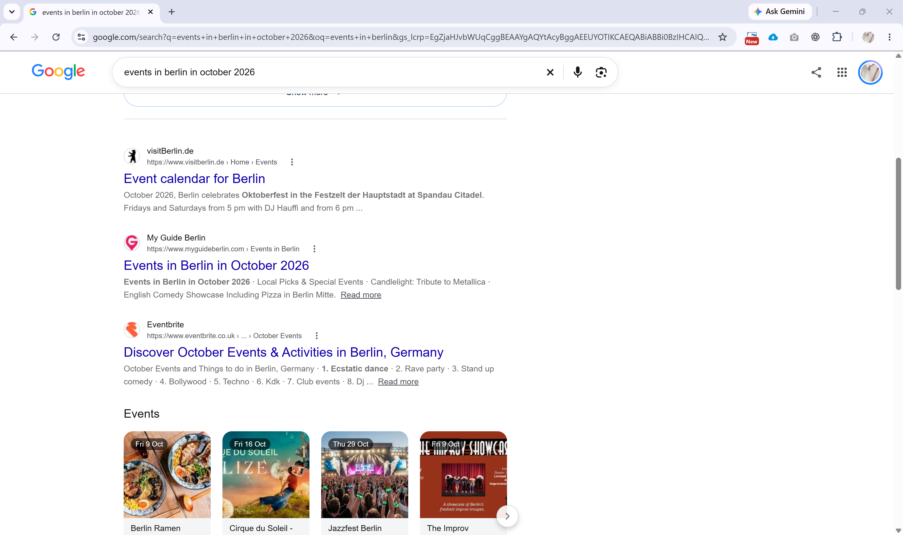
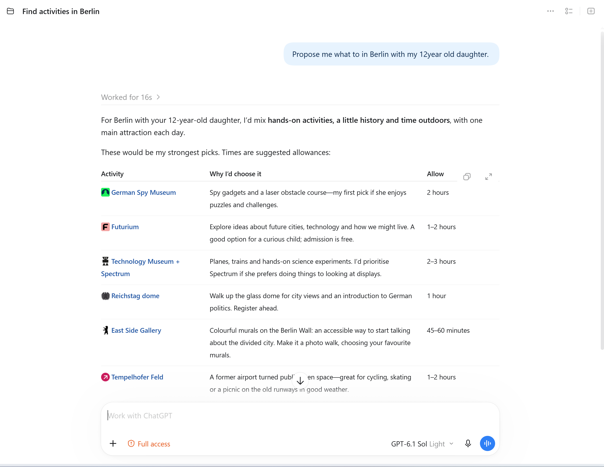
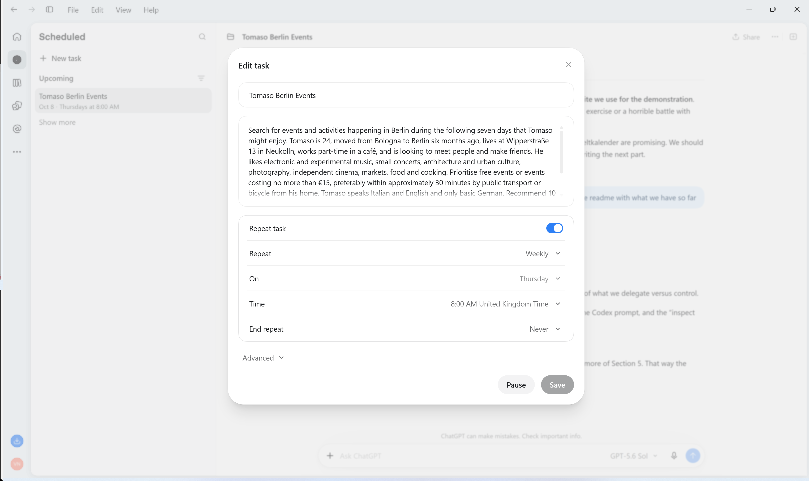
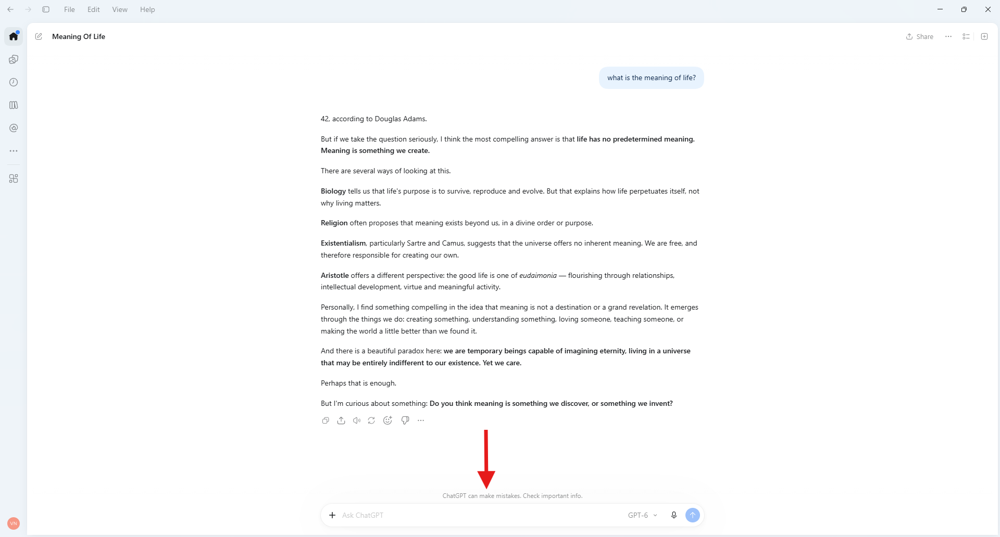
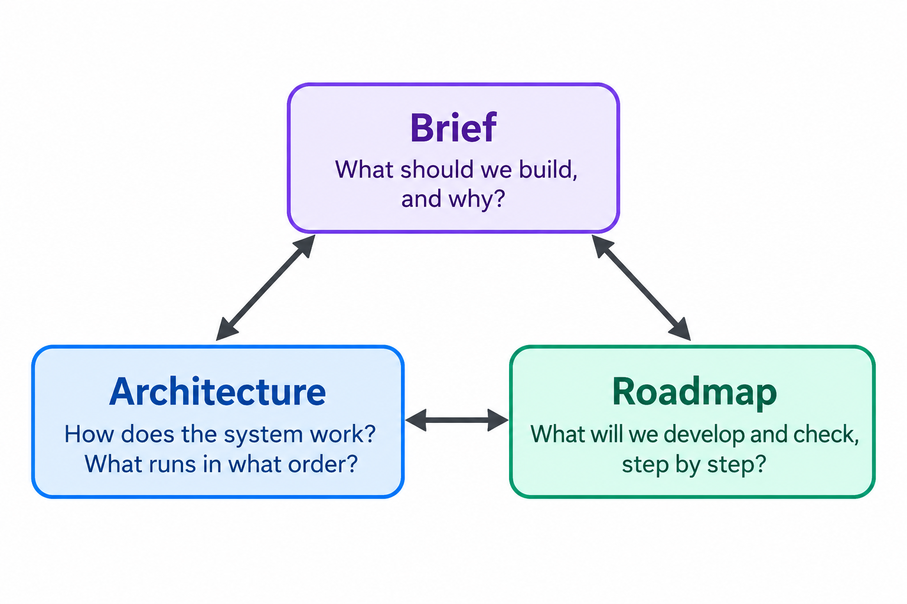
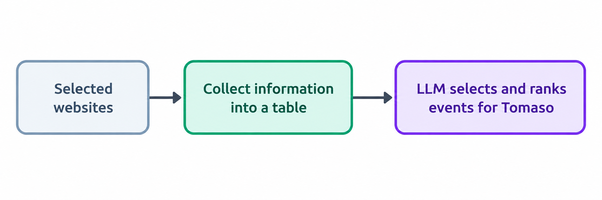
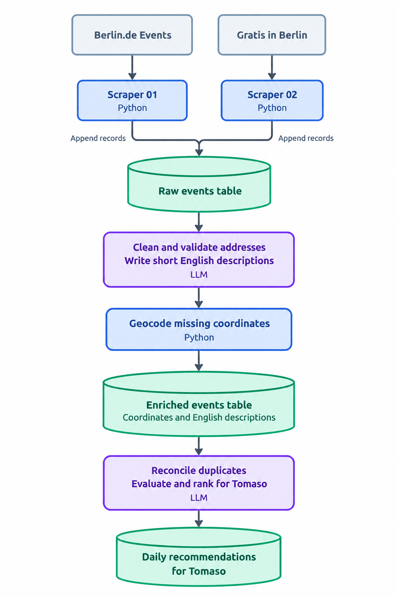

# Exercise 04 — Agentic Coding

Large language models can do more than answer questions or generate code. When connected to tools, an **AI agent** can pursue a goal through several steps: searching for information, inspecting results, deciding what to do next and, when permitted, taking further actions.

This is different from a conventional program, where we specify the operations in advance, and from a single exchange with a chatbot. In an **agentic workflow**, we delegate some decisions about *how* to complete a task. The agent does not necessarily act without us: we can define limits, inspect intermediate results and decide which actions require approval.

For urban research, this creates opportunities to collect and interpret information that would otherwise take considerable manual effort. It also raises methodological questions. Which sources did the agent choose? Which results did it exclude? What assumptions did it make? Can we verify its work and repeat the process?

We will investigate these questions in two stages:

- **Agentic search:** delegate the discovery of Berlin events to an AI agent and evaluate its recommendations.
- **Agentic coding:** work with a coding agent to build a more explicit, testable process for collecting event information.

Both stages start with the same problem. The difference is **where we place control**: first we delegate much of the search; then we decide how the search should operate and ask an agent to help implement it.

## 1. Agentic Search

A conventional web search begins with a **query**, such as *experimental music Berlin this weekend*. A search engine returns a collection of pages, and we decide which ones are relevant.

**Query → Search → Results → Human interpretation**



With agentic search, we describe a **goal** rather than just a query. For example, we might ask an agent to find activities suitable for someone who has recently moved to Berlin. The agent may try several searches, inspect different sources, compare information and refine its approach before presenting recommendations.

**Brief → Search → Inspect sources → Compare and filter → Recommendations**



The distinction is not simply that the answer is longer or more personalised. The important change is that the agent makes **intermediate decisions**. It decides which searches to try, which pages to inspect and which results to include. These decisions depend on its instructions, the tools it can access and the information available. They may also be mistaken.

This makes agentic search particularly interesting for urban research. The same city can offer very different possibilities depending on someone's interests, income, mobility, language or available time. A search designed for a particular person can reveal those differences—but only through the assumptions built into the brief and the agent's choices.

In this exercise, we will work with **Tomaso**, a fictional resident of Berlin. First, we will ask an agent to find activities for him. Then we will examine what it found, what it missed and whether we can verify its claims. Finally, we will take control of more of the process by designing a repeatable data-collection workflow.

The aim is not merely to obtain convincing recommendations. It is to understand **how a result was produced, what we can trust and which decisions we should keep under our control**.

## 2. Meet Tomaso


**Tomaso Bianchi** is a 24-year-old Italian who moved from Bologna to Berlin six months ago. He lives at **Wipperstraße 13 in Neukölln** and works part-time in a café.

His income is limited, so he generally looks for **free activities or events costing no more than €15**. He doesn't own a car and travels by **walking, bicycle and public transport**. He prefers things within about **30 minutes of home**, although he is willing to travel further for something exceptional.

Tomaso speaks **Italian and English** and is learning German, but is not yet comfortable attending events that require fluent German.

He is interested in **electronic and experimental music, small concerts, architecture and urban culture, photography, independent cinema, markets, food and cooking**. He enjoys discovering less obvious parts of Berlin rather than conventional tourist attractions or large commercial events.

Most importantly, Tomaso is **still building a social life in Berlin**. He would like to meet new people and make friends, so he particularly values events and activities that encourage **conversation, participation or repeated encounters**, rather than simply attending as a spectator.

Because he works irregular shifts, **evenings and weekends** are usually the best times for him.

## 3. Your First Agent

Instead of searching for events ourselves, we can ask ChatGPT to search on Tomaso's behalf. We will **run the search once**, inspect what it finds and then optionally schedule it.

A **one-off agentic search** runs when we ask for it. A **scheduled task** runs a similar brief at a specified time, such as every Thursday. Scheduling does not make the results more accurate; it only makes the task repeat. We still need to examine where the information came from and whether it is reliable.

> **Every Thursday, find things Tomaso could do in Berlin during the coming week.**

No Python is required for this first experiment. We describe the goal in natural language, let ChatGPT search and inspect the results before adding a schedule.



### Exercise — Run the search

Start a new ChatGPT conversation and use a prompt similar to:

> Search for events and activities happening in Berlin during the next seven days that Tomaso might enjoy.
>
> Tomaso is 24, moved from Bologna to Berlin six months ago, lives at Wipperstraße 13 in Neukölln, works part-time in a café, and is looking to meet people and make friends. He likes electronic and experimental music, small concerts, architecture and urban culture, photography, independent cinema, markets, food and cooking.
>
> Prioritise free events or events costing no more than €15, preferably within approximately 30 minutes by public transport or bicycle from his home. Tomaso speaks Italian and English and only basic German.
>
> Recommend up to 10 activities that you can substantiate. For each recommendation provide the **event name, date, time, venue, full address, latitude, longitude, price, original source URL, and a short explanation of why it suits Tomaso**. Use decimal degrees for coordinates you can support. Leave unknown coordinates blank and mark unconfirmed prices or journey times as uncertain. Link to the specific event page where possible.

The requested output has a simple spatial data structure:

`event | date | time | venue | address | latitude | longitude | price | source_url | recommendation`

Run this **one-off search** first. Read the recommendations and open some of their source links. For an optional scheduling demonstration, ask ChatGPT to run the same brief every Thursday for the following seven days. The coding exercise below uses a separate, fixed Monday–Sunday window so you can compare reruns.

The original sources and dates matter more than how convincing the final recommendations sound. The next step is to check this.

### Reference run — 4 October 2026

We tested the brief with a live search for **5–11 October 2026**. The table below is kept as a reference example of the agent's output. It is useful precisely because it is not perfectly clean: some information can be verified directly, while other fields depend on interpretation or secondary lookup.

| Event | Date / time | Venue / address | Lat | Lon | Price | Why it fits Tomaso | Source |
|---|---|---|---:|---:|---|---|---|
| Creative Media Lab | Wed 07.10, 16:00–18:00 | Medienkompetenzzentrum Neukölln, Mittelweg 30, 12053 Berlin | 52.47475 | 13.43519 | Free | Hands-on media workshop involving film, VR and 3D printing; local and participatory. | https://jup.berlin/events/creative-media-lab |
| Open Calligraphy Workshop | Thu 08.10, 16:00–20:00 | Stadtteilzentrum Kiezbegegnung, Warthestraße 73, 12051 Berlin | 52.47017 | 13.42693 | Free | Drop-in creative activity with no prior knowledge required; strong potential for informal interaction. | https://www.gratis-in-berlin.de/component/flexicontent/36-kunst/2072643-offene-kalligraphie-werkstatt-in-neukoelln |
| Open Lab: Recycling, Repackaged | Thu 08.10, 17:00–20:00 | Futurium, Alexanderufer 2, 10117 Berlin | — | — | Free | Participatory workshop combining AI, design and future thinking; further away, but unusually close to Tomaso's interests. | https://www.berlin.de/en/tickets/education-lectures/open-lab-evening-recycling-repackaged/2026-10-08-n-a-b5bf2e04-fc8f-4013-a4f2-1dd82832cd61/ |
| 52nd Berlin Night of Spiritual Songs | Fri 09.10, 19:30–23:00 | Martin-Luther-Kirche, Fuldastraße 50, 12045 Berlin | 52.48431 | 13.43584 | Free / donation | Collective singing rather than passive spectatorship; very local and explicitly social. | https://www.eli-berlin.de/liedernacht/ |
| Big Band Night 2026 | Fri 09.10, 19:30 | Kulturstall, Schloss & Gutshof Britz, Alt-Britz 81, 12359 Berlin | 52.4469 | 13.4378 | Free / pay what you can | Live music in Neukölln with a low financial barrier. | https://www.berlin.de/musikschule-neukoelln/veranstaltungen/big-band-night-1295669.php |
| Sound Canteen w/ Tobi Fries | Fri 09.10, 20:00 | Orangerie Neukölln, Schierker Straße 8, 12051 Berlin | 52.47058 | 13.43609 | Free | Ambient/Balearic music in a small local venue; close to Tomaso's electronic-music interests. | https://www.orangerie-nk.de/ |
| Klangstraße Music Festival | Fri 09.10, 15:00–21:00 | Multiple venues along Residenzstraße, 13409 Berlin | — | — | Free | 27 short concerts across 15 locations; further away, but informal, exploratory and easy to move between. | https://www.berlin.de/events/7755495-2229501-reinickendorfer-klangstrasse.html |
| Gartenrundgang | Sat 10.10, 11:00–13:00 | KGA Zufriedenheit, Koppelweg 30, 12347 Berlin | — | — | Free | Urban gardening, discussion and shared knowledge in a relaxed setting; strong social potential. | https://www.umweltkalender-berlin.de/angebote/details/99663?dat=2026-10-10 |
| Mit allen Sinnen im Waldgarten | Sat 10.10, 15:00–16:30 | Waldgarten Berlin-Britz, Leonberger Ring 54, 12349 Berlin | 52.42721 | 13.42883 | Free | Guided sensory walk through a community garden; participatory and locally grounded. Registration required. | https://www.umweltkalender-berlin.de/angebote/details/99821?dat=2026-10-10 |
| Gardens of Disco | Sat 10.10, 21:00 | Orangerie Neukölln, Schierker Straße 8, 12051 Berlin | 52.47058 | 13.43609 | €12 | Small-scale Disco, Italo, House and experimental electronic music in a local setting; probably the strongest music match. | https://www.orangerie-nk.de/ |

### Exercise — Verify three recommendations

Select **three events** from your own search results. For each event, open its **original organiser or venue page**, where available, rather than relying only on an event aggregator. Record whether you can confirm:

- **Date and time:** Is the event happening during the requested week?
- **Price and access:** Is the stated price correct? Are there booking requirements or age restrictions?
- **Place:** Does the address match the venue? Are the coordinates plausible?
- **Source:** Does the link lead to information about this particular event, rather than a generic homepage?

Mark each field as **verified**, **uncertain** or **incorrect**, and note the source you checked. If you cannot establish a fact, leave it uncertain instead of guessing. Compare the verification with the agent's original recommendation: did any result become less suitable for Tomaso?

Copy this table and add a row for each field you check. The first row shows how to record a gap in the reference run.

| Event | Field | Agent reported | Evidence checked | Status |
| --- | --- | --- | --- | --- |
| Sound Canteen w/ Tobi Fries | Source | Orangerie Neukölln link | The reference table links to the venue homepage. The link does not identify a particular event page. | Uncertain |
| | | | | |

### First observations

At first sight, the result is impressive. The agent has searched for current events, interpreted Tomaso's preferences and returned structured spatial data. But the table also exposes the limits of the process.

Not every requested field is equally reliable. Proximity to Tomaso's home may be inferred from a neighbourhood rather than calculated as travel time. The likelihood of meeting people is an interpretation of an event description. Coordinates may require a second lookup, and for distributed events such as **Klangstraße**, a single coordinate may be the wrong representation altogether. Unresolved coordinates are therefore left blank rather than given false precision.

The search also combines very different kinds of sources: event aggregators, neighbourhood websites, public calendars and individual organisers. The agent decides which sources to search, which results to ignore and which events to recommend.

Checking the results can change the answer. An apparently suitable creative workshop from an earlier search turned out to be intended for **10–18 year olds**. **MUSK ON MARS**, another strong-looking recommendation, was listed from **€20** and therefore exceeded Tomaso's €15 budget.

More importantly, agentic search is **not guaranteed to be factually correct**. A result may contain an incorrect date, an outdated or broken link, a wrong address, or occasionally an event that cannot be verified at all. Better instructions — for example, requiring original source pages and asking the agent to verify each event — can reduce these errors, but they cannot remove the risk completely. ChatGPT itself warns that it can make mistakes and that important information should be checked.



For casual discovery, a result that is *mostly correct* may still be useful. For a data-collection workflow, however, **a plausible recommendation is not yet a verified data record**. A few invented or incorrect records can contaminate the dataset and affect everything that happens afterwards.

This gives us a reason to look beyond the quality of the recommendations themselves. The problem is not simply whether the answer looks convincing; it is that the **method is opaque**.

We know the brief and we can see the output, but we do not yet know exactly how the agent moved from one to the other.

> **What actually happened?**

## 4. Inside the Search

We gave the agent Tomaso's profile and received ten recommendations. The result looks like a simple table, but producing it involved several different kinds of work.

**Brief → Search → Extract → Interpret → Filter → Rank → Output**

This is a useful *model* of the workflow, not a record of the agent's exact internal steps. Unless we can inspect its tool calls and intermediate results, we cannot assume that it followed this sequence or checked every field.

Consider what the agent might have had to decide:

- **Search:** Which websites, event calendars and queries should it use?
- **Extract:** What do the sources actually say about dates, prices, venues and access?
- **Interpret:** Does an event seem social, accessible and relevant to Tomaso?
- **Filter:** Which events appear to meet his budget, travel and language constraints?
- **Rank:** Which ten events should appear in the final recommendations?

These decisions are not all the same. An event's advertised **price** is a source fact that we can check. Whether the event is a **good place to make friends** is an interpretation. A **30-minute journey** requires a route and a mode of transport, not just an address. The resulting table can make all three look equally certain, even when they are not.

### From a convincing answer to a reproducible method

In our first experiment, we specified the **input** (Tomaso's brief) and the **output** (ten recommendations), but we did not define or record each step in between. The agent may have chosen different websites or made different judgements on another run. Even when the output looks plausible, we may struggle to explain why one event was selected and another was ignored.

For a reproducible urban dataset, we want to be able to answer more specific questions: **Where did each record come from? When was it collected? Which details were missing? Which decisions were made by code, and which by an LLM?**

That leads to the main question for the next part of the exercise:

> **Which decisions should we delegate to AI, and which should we make explicit in our workflow?**

### Taking control of the search

One place to intervene is at the beginning. Instead of allowing an agent to choose any source on the web, we can select a small set of Berlin event websites ourselves.

**Selected sources → Python scrapers → Shared events table → Later interpretation and recommendations**

Each scraper will collect source information in a consistent format, keeping the original links and leaving unknown fields blank. We can inspect the resulting rows against their source pages, run the collection again for another week and see which stage failed if the data is incomplete.

This does not make the dataset automatically accurate: websites change, scrapers can misread pages and sources can contain errors. It does, however, give us a **visible process that we can test and revise**.

The role of AI changes. Instead of asking it to carry out the entire search and deliver a finished answer, we will ask a coding agent to **help us construct and test the collection process**, one part at a time.

## 5. Building a Controlled Search

Your first goal in Codex is to collect events from **one website for one week**, save them to **one CSV**, and check the rows in pandas. You will make the decisions about what to collect and how to verify it. Codex will help you write and test the Python script.



The **brief** says what the system should do. The **architecture** shows how its parts fit together. The **roadmap** gives you an order in which to build and check those parts.

### 5.1 Overall Architecture



A **scraper** is a script that extracts information from web pages. Each source has its own page structure, so we will develop one scraper per website. The scripts use the same CSV columns so their outputs can be combined.



**Colour key** — Blue = Python script · Green = table · Purple = LLM action.

The diagrams show the full plan. Start with [Berlin.de Events](https://www.berlin.de/en/events/). [Gratis in Berlin](https://www.gratis-in-berlin.de/) is the next source once the first scraper works. Enrichment, recommendations and Monday scheduling come later.

### 5.2 Start in Codex

Open a writable project folder in Codex and make this README available in the workspace. If Codex cannot see the file, paste this section into the conversation. Before you begin, open Berlin.de Events and choose a **Monday–Sunday week with visible listings**. Write down both dates in Berlin local time and keep them fixed when you rerun the script. For example, `2026-11-23` to `2026-11-29` illustrates the format. Choose a week the site actually shows when you run the exercise.

Paste this first prompt and replace the two date placeholders:

> Read the “Start in Codex” section of the Agentic Coding README in this workspace, or use the excerpt I provide. Plan a small Python scraper for https://www.berlin.de/en/events/. Use the fixed date range START_DATE to END_DATE, inclusive, in Berlin local time. Inspect a listing and a few event pages. Tell me how you would find the events, which fields the pages provide, what might cause the collection to fail, and how I can check three sample records. Start by proposing a plan. Wait for my feedback before writing code.

Review the plan together. For the first pass, aim to collect the **event name, date, time, venue, price and event-page URL** where the source provides them. Include the source name and collection timestamp. Leave the remaining columns blank when they are unavailable or outside this first pass.

Use this CSV schema in this order:

`event | date | end_date | time | end_time | venue | address | latitude | longitude | price | category | description | language | age_restrictions | registration | source | source_url | collected_at`

Use `YYYY-MM-DD` for dates. Include a multi-day event when the source shows that it overlaps the selected week, even if it starts before Monday. Keep the original start and end dates. Preserve source wording for fields such as price, and leave coordinates blank unless the source provides them in decimal degrees.

Once the plan makes sense, use this follow-up:

> Implement only the Berlin.de scraper using the agreed dates and CSV schema. Save the results to `berlin_de_events.csv` in the project folder. A successful rerun should replace this file with a fresh result for the same week. Preserve the event-page links, leave unknown values blank and keep any overlapping records. Report pages you could not read so I can distinguish incomplete collection from a week with no events. Give me the dependency installation steps, the exact command to run from the project folder, the expected CSV path and the checks you performed.

### 5.3 Run and check the first CSV

1. Open a terminal in your project folder and run the command Codex gave you. Check that `berlin_de_events.csv` appears there.
2. Open the CSV using the approach from [Exercise 01 — Pandas](../Exercise%2001%20-%20Pandas/Exercise%2001%20-%20Pandas.ipynb). Run this in a notebook whose working directory is your project folder, or adjust the path to the CSV.

   ```python
   import pandas as pd

   events = pd.read_csv("berlin_de_events.csv")
   print(events.shape)
   events[["event", "date", "venue", "price", "source_url"]].head()
   ```

3. Trace **three rows** back to their event pages. Compare the date, venue and price where available. If the scraper returns fewer than three rows, check every row and revisit the listings to understand the limited result.
4. Rerun the same command for the same dates and check that it refreshes the file. Row counts can change if the source changes. Explain one limitation you observed, such as missing prices, ambiguous dates or pages the script could not read.

You have reached the workshop checkpoint when you can **rerun the scraper, inspect the CSV in pandas, and explain what your source checks showed**. If a check fails, show Codex the affected row and source page and ask it to explain the discrepancy before changing the script.

### 5.4 Extend the workflow

1. **Add Gratis in Berlin.** Use the same dates and columns. Write a separate `gratis_in_berlin_events.csv` and check its rows against their sources.
2. **Combine the files.** Rebuild the combined CSV from the two source CSVs each time. Keep overlapping records and their source links so you can compare them.
3. **Enrich the data.** Preserve the original addresses and descriptions. Add cleaned addresses and factual English descriptions. Geocode missing coordinates in a shared step and record where each coordinate came from.
4. **Rank events for Tomaso.** Use the enriched table and his profile. Keep a link to the source for each recommendation and flag uncertain information.
5. **Automate the checked pipeline.** Run it on Mondays for the Monday–Sunday week in Berlin local time and record any collection failures.

If you are working in Git, commit each working stage so you can see what changed and return to a version you have already checked.
