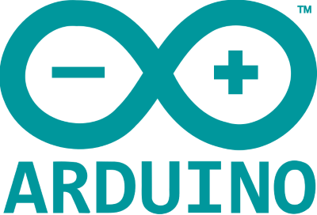
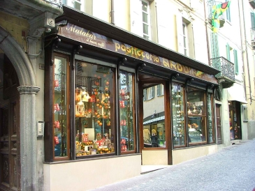
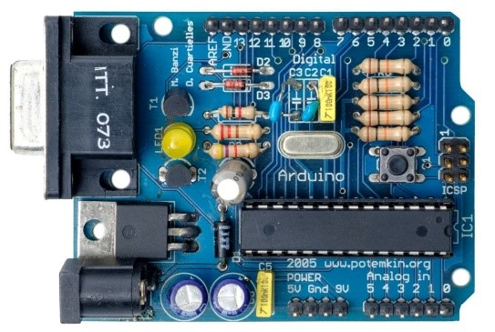
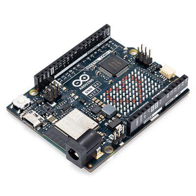
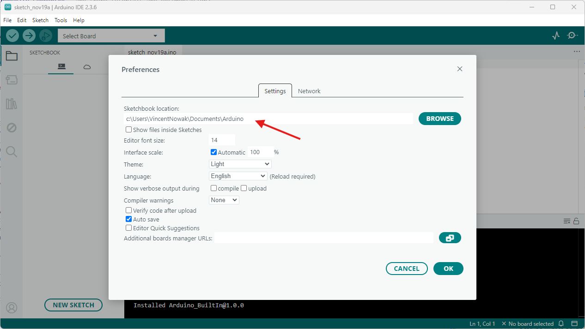
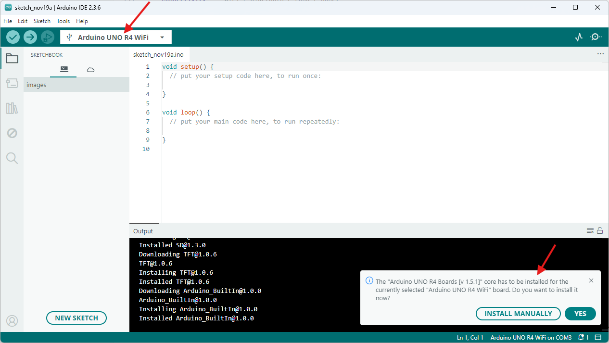
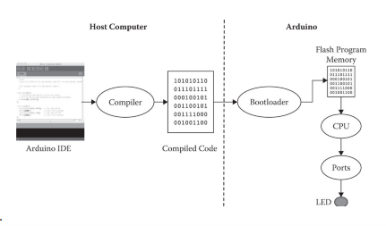

# Day 1 — Introduction to Arduino and Programming

**RC15 Skills · Prosthetic Clouds · 2026/27 · 4-hour live coding workshop**

This tutorial accompanies the live coding session. It is also a reference you can return to afterwards. We will work with an **Arduino Uno R4 WiFi** and gradually build up from a blinking LED to variables, functions, conditions, loops, arrays and communication with a computer.

**Learning outcomes:** By the end of the session, you should be able to read and modify a simple Arduino sketch, recognise the fundamental structures of C/C++, upload a program, and identify basic compilation and behavioural errors.

## 1. What is Arduino, and where does it come from?

**Arduino** is an open-source electronics platform for creating interactive projects. It combines physical boards, programming tools and a large community of shared examples and libraries.

Arduino emerged in the mid-2000s from the **Interaction Design Institute Ivrea (IDII)** in Italy. Massimo Banzi and collaborators helped develop an accessible platform for students, artists and designers who wanted to experiment with electronics without needing an engineering background. The project's open-source approach helped it spread through education, design and prototyping.



The [Bar Arduino in Ivrea](https://maps.app.goo.gl/5wCvfxTnYhPhZHdi7), which gave the project its name.



An early Arduino prototype.

[Arduino official website](https://www.arduino.cc/)

### What is programming?

A **program** is a set of instructions that tells a computer or microcontroller what to do. **Programming** means writing and organising those instructions. In this workshop we use **Arduino C/C++**.

Many interactive systems can be understood as a sequence:

**INPUT → PROCESS → OUTPUT**

For example, a sensor measures light (**input**); the program checks whether the room is dark (**process**); and an LED switches on (**output**). Today we begin with the simplest output—the built-in LED—so we can concentrate on learning the language.

### What can Arduino do?

Arduino boards can read sensors and control LEDs, motors, displays and other electronic components. They are useful for responsive objects, environmental measurements, wearable devices and physical prototypes.

### Arduino and Raspberry Pi: what is the difference?

Students may already know the Raspberry Pi, but the two devices are designed for somewhat different purposes. Here we compare our **Arduino Uno R4 WiFi** with a conventional **Raspberry Pi single-board computer**.

| Feature | Arduino Uno R4 WiFi | Raspberry Pi computer |
| --- | --- | --- |
| Type | Microcontroller board | Single-board computer |
| Operating system | No conventional operating system required for a sketch | Usually runs Linux |
| Programming | Primarily C/C++ through the Arduino environment | Python, C/C++ and many other languages |
| Operation | Runs the uploaded program directly | Runs applications through an operating system |
| Typical use | Sensors, actuators, responsive objects | Multimedia, networking, general computing |
| Power consumption | Generally lower | Generally higher |

Neither device is universally better. Some newer products also combine microcontrollers and computer-like capabilities, so the distinction is not absolute.

## 2. From Sensors to Spatial Ideas

Before we begin programming, consider what a microcontroller makes possible. Arduino can connect **inputs** (what a device senses) with **outputs** (how it responds). In an urban investigation, that might mean recording a walk, making an invisible condition perceptible, or extending the body's capacity to sense its surroundings.

The ambition is not simply to attach electronics to clothing. Ask what the device reveals, how it changes the wearer's experience, and whether its measurements support the question being investigated.

### Discover the World of Sensors

Human perception is limited. We see only a small portion of the electromagnetic spectrum, hear only a limited range of frequencies and remain largely unaware of many physical and chemical processes taking place around us.

Electronic sensors allow us to extend these boundaries. Imagine feeling the magnetic landscape of a city, hearing vibrations travelling through buildings, or perceiving changes in air quality through your clothing. The following sensor families offer starting points for developing your own prosthetic senses.

#### 01 — Beyond human vision

*What would the city look like if we could see beyond visible light?*

| Sensor | What it reveals |
| --- | --- |
| Infrared thermal camera | Patterns of surface temperature |
| Infrared thermometer | Surface temperature without contact |
| Ultraviolet sensor | UV radiation |
| Multispectral sensor | Different wavelength bands of light |
| Colour sensor | Colour and illumination |
| Ambient light sensor (LDR / BH1750) | Light intensity and shadow |

**Design provocations:** Imagine a garment that makes the warmth of surrounding buildings perceptible through vibration, or translates ultraviolet radiation into sound. Surface emissivity, shadows and sensor orientation affect measurements.

Explore: [Adafruit multispectral sensor](https://learn.adafruit.com/adafruit-as7341-10-channel-light-color-sensor-breakout)

#### 02 — Spatial awareness and echolocation

*What if you could perceive space without using your eyes?*

| Sensor | What it reveals |
| --- | --- |
| Ultrasonic distance sensor | Distance using reflected sound |
| Time-of-flight sensor | Distance using reflected light |
| Scanning LiDAR | Spatial profiles of surroundings |
| Millimetre-wave radar | Movement and, with suitable modules, stationary presence |
| Doppler radar | Movement and radial velocity |
| Passive infrared sensor | Changes in thermal radiation associated with movement |

**Design provocations:** Could a wearable extend your field of perception to 360 degrees? Imagine feeling the width of a street or the proximity of people behind you through a pattern of vibrations. Range and accuracy depend on the environment and target.

Explore: [Seeed Studio radar sensors](https://wiki.seeedstudio.com/mmwave_radar_Intro/)

#### 03 — The invisible atmosphere

*What if you could sense the chemical and physical composition of the air?*

| Sensor | What it reveals |
| --- | --- |
| Particulate-matter sensor (PM2.5 / PM10) | Airborne particle concentrations |
| CO₂ sensor | Carbon dioxide concentration |
| VOC sensor | Changes in volatile organic compounds |
| Gas-specific sensor | Selected gases such as NO₂ or ozone |
| Temperature and humidity sensor | Local thermal and moisture conditions |
| Barometric pressure sensor | Atmospheric pressure |
| Anemometer | Wind speed |
| Electronic nose | Patterns of responses across multiple gas sensors |

**Design provocations:** Imagine a garment that responds to the changing atmosphere as you walk between traffic, parks and underground stations. Could you map the chemical landscape of a city? Gas sensors can be cross-sensitive and require calibration; particulate sensors need airflow, and body heat can distort temperature readings.

Explore: [Seeed Studio gas sensor guide](https://wiki.seeedstudio.com/Seeed_Gas_Sensor_Selection_Guide/) · [Particulate-matter sensor](https://wiki.seeedstudio.com/Grove-Laser_PM2.5_Sensor-HM3301/)

#### 04 — Listening beyond human hearing

*What does the city sound like beyond the limits of our ears?*

| Sensor | What it reveals |
| --- | --- |
| Microphone | Airborne sound |
| Contact microphone | Vibrations travelling through solid materials |
| Ultrasonic microphone | Sound above human hearing range |
| Infrasound sensor | Very low-frequency pressure waves |
| Hydrophone | Sound travelling through water |
| Geophone | Ground vibrations |
| Piezoelectric sensor | Mechanical vibrations and deformation |

**Design provocations:** What does a bridge sound like when you listen to its structure rather than the surrounding air? Could you hear underground trains through the ground or discover bats at night? A basic microphone does not provide calibrated decibel measurements.

Explore: [Adafruit piezo sensor](https://www.adafruit.com/category/35)

#### 05 — Invisible fields and radiation

*What if we could sense the technological landscape that surrounds us?*

| Sensor | What it reveals |
| --- | --- |
| Magnetometer | Strength and direction of magnetic fields |
| Hall-effect sensor | Local magnetic field variations |
| Electric-field sensor | Changes in surrounding electric fields |
| Electromagnetic pickup coil | Fluctuating magnetic fields |
| Radio receiver | Activity within selected radio frequencies |
| Geiger counter | Ionising radiation events |
| Lightning detector | Electromagnetic signals associated with lightning |

**Design provocations:** Imagine walking through a city and hearing an entirely different landscape generated by electrical infrastructure, transport and electronic devices. Could you develop a sense of magnetic north? Use enclosed, purpose-built radiation instruments rather than constructing high-voltage circuits.

Explore: [Christina Kubisch — Electrical Walks](https://electricalwalks.org/)

#### 06 — The invisible body

*What is happening inside our bodies that we are not consciously aware of?*

| Sensor | What it reveals |
| --- | --- |
| GSR / EDA | Changes in skin conductance |
| Optical pulse sensor (PPG) | Pulse and changes in blood volume |
| ECG sensor | Electrical activity of the heart |
| EMG sensor | Electrical activity of muscles |
| EEG sensor | Electrical activity measured at the scalp |
| Respiration sensor | Breathing patterns |
| Skin temperature sensor | Changes in skin temperature |
| Eye-tracking sensor | Direction of gaze |

**Design provocations:** Could a garment make its wearer's physiological responses perceptible to another person? Could two people experience each other's breathing patterns? Physiological signals do not directly reveal emotions, thoughts or intentions. Use purpose-designed body-safe equipment and follow its power and isolation requirements.

Explore: [BITalino biosignal sensors](https://bit.lx.it.pt/bitalino/)

#### 07 — An extended sense of touch

*What if your skin could extend beyond the boundaries of your body?*

| Sensor | What it reveals |
| --- | --- |
| Force-sensitive resistor | Applied force (requires calibration) |
| Capacitive sensor | Touch and proximity |
| Stretch sensor | Material elongation |
| Bend sensor | Material deformation |
| Strain gauge | Small changes in material dimensions |
| Artificial whiskers | Contact, deflection or airflow |
| Tactile sensor array | Distribution of contact across a surface |
| Conductive textile sensor | Changes in resistance or capacitance |

**Design provocations:** Imagine flexible whiskers extending from a garment, artificial skin responding to contact, or fabric detecting airflow. Geometry, arrangement and material composition influence how these sensors behave; moisture and mounting can also affect readings.

Explore: [KOBAKANT — soft sensors](https://www.kobakant.at/DIY/)

#### 08 — Movement, orientation and gravity

*Can we develop a greater awareness of how our bodies move through space?*

| Sensor | What it reveals |
| --- | --- |
| Accelerometer | Acceleration and, when stationary, inclination |
| Gyroscope | Rotational velocity |
| Magnetometer | Magnetic orientation |
| Inertial measurement unit (IMU) | Combined movement measurements |
| GPS / GNSS | Geographical position and time |
| Barometric altimeter | Estimated changes in elevation |
| Optical flow sensor | Relative movement across a visible surface |
| Foot pressure sensor | Distribution of pressure while walking |

**Design provocations:** Could you recognise urban surfaces through the vibrations transmitted to your feet? Could you map not only where someone went but how they moved? GPS reception can be poor indoors and between tall buildings; orientation estimates may drift.

Explore: [Arduino sensor tutorials](https://docs.arduino.cc/)

#### 09 — Sensing other forms of life

*What if we could perceive the city from the perspective of another organism?*

| Sensor | What it reveals |
| --- | --- |
| Soil moisture sensor | Water content of soil |
| Soil conductivity sensor | Electrical conductivity of soil |
| Leaf wetness sensor | Moisture on plant surfaces |
| Dendrometer | Small changes in plant stem diameter |
| Plant electrophysiology sensor | Electrical potential variations in plant tissue |
| Ultrasonic acoustic detector | Acoustic activity of certain animals |
| Underwater pH sensor | Acidity or alkalinity of water |
| Dissolved oxygen sensor | Oxygen concentration in water |

**Design provocations:** Could a wearable communicate aspects of the conditions experienced by a tree? Could an installation respond to ecological processes unfolding over hours, days or seasons? These measurements are proxies for environmental conditions, not direct access to another organism's experience.

Explore: [Open-source dendrometer research](https://pmc.ncbi.nlm.nih.gov/articles/PMC10953470/)

Two examples of the components we will actually use in **Day 2**:


*GSR sensor: records changes in skin conductance, not a direct measure of emotion.*


*GPS receiver: provides position and time, which can give sensor readings a spatial context.*

**Analogue or digital?** Some sensors produce a changing voltage that Arduino reads with `analogRead()`. Others contain their own electronics and send measurements over a digital interface such as **I²C, UART or SPI**. The connector shape alone does not identify the protocol. We will investigate these distinctions in Day 2.

### Responsive Textiles and Wearable Technologies

Sensors are only half the story. Electronics do not need to remain separate from the material structure of a wearable. Light can be woven into fabric, movement can transform its silhouette and circuits can be embroidered into its surface. Think of the wearable as a programmable material that can change its appearance, geometry and behaviour.

#### 01 — Light as a material

*What if light became part of the fabric itself?*

| Technology | Design possibilities |
| --- | --- |
| Individual LEDs | Points of light distributed across a garment |
| Addressable LEDs | Animated patterns and individually controlled colours |
| Flexible LED matrices | Low-resolution animated textile surfaces |
| Fibre optics | Weaving and distributing light through fabric |
| Electroluminescent wire | Continuous illuminated lines |
| Electroluminescent panels | Thin illuminated surfaces |
| Diffusing materials | Soft, indirect illumination integrated into clothing |

**Design provocations:** Imagine illuminated patterns generated by the movement of the wearer, or a textile that gradually changes colour in response to the environment.

Explore: [Adafruit wearables](https://learn.adafruit.com/category/wearables)

#### 02 — Kinetic wearables

*What if clothing could move independently of the body?*

| Technology | Design possibilities |
| --- | --- |
| Micro servo motors | Rotating and articulating individual elements |
| Geared DC motors | Continuous rotation and mechanical movement |
| Linear actuators | Extending and retracting elements |
| Shape-memory alloys | Movement through controlled material deformation |
| Pneumatic actuators | Inflating and contracting soft structures |
| Electromagnets | Controlled attraction and mechanical movement |

**Design provocations:** Imagine a garment that expands when someone approaches, a collar unfolding in response to sound, or an articulated surface changing geometry as its wearer moves. The mechanism itself can become part of the design language.

Explore: [Anouk Wipprecht](https://www.anoukwipprecht.nl/)

#### 03 — Haptic and tactile experiences

*What if clothing could communicate privately with its wearer?*

| Technology | Design possibilities |
| --- | --- |
| Vibration motors | Localised tactile signals |
| Linear resonant actuators | Controlled vibration patterns |
| Pneumatic pockets | Pressure against the body |
| Mechanical actuators | Tapping, pulling or brushing the skin |
| Peltier elements | Controlled warming or cooling with appropriate safeguards |
| Small speakers and transducers | Audible or material-borne sound |

**Design provocations:** A wearable could create a private sensory experience invisible to surrounding people: a rhythm on the shoulder, a gentle vibration indicating direction, or a tactile pattern that changes during a walk.

Explore: [Adafruit wearable projects](https://learn.adafruit.com/category/wearables)

#### 04 — Transforming surfaces

*What if a textile could change its physical properties?*

| Technology | Design possibilities |
| --- | --- |
| Thermochromic pigments | Colour changes in response to temperature |
| Photochromic pigments | Colour changes in response to light |
| Electrochromic materials | Electrically controlled colour or opacity |
| Shape-memory materials | Changes in geometry |
| Inflatable textile structures | Changes in volume and stiffness |
| Origami and kirigami mechanisms | Folding, unfolding and expansion |

**Design provocations:** The material itself becomes an active component rather than simply a support for electronics. Some materials respond directly to their environment; others can be controlled through a programmed actuator.

Explore: [Studio Roosegaarde — Intimacy](https://www.studioroosegaarde.net/project/intimacy)

#### 05 — Electronic textiles and soft circuits

*What if the circuit itself became part of the garment?*

| Technology | Design possibilities |
| --- | --- |
| Conductive thread | Embroidered electrical connections |
| Conductive fabric | Flexible electrical surfaces and contacts |
| Conductive yarn | Knitted and woven circuits |
| Fabric switches | Soft buttons integrated into clothing |
| Flexible PCBs | Thin circuits following curved surfaces |
| Conductive inks | Printed electrical patterns |
| Snap connectors | Removable electrical connections |

**Design provocations:** How might components be positioned, concealed, celebrated or integrated into a wearable? This is a direct connection to Sensing Surfaces: the circuit can be designed alongside the textile rather than attached afterwards.

Explore: [KOBAKANT — How to Get What You Want](https://www.kobakant.at/DIY/)

**Practical considerations:** These are possibilities to explore, not a required shopping list. Check board compatibility, voltage, current, power requirements and material integration before choosing components. Motors and high-power LEDs need suitable drivers and power supplies rather than direct connection to Arduino pins. Electroluminescent lighting, heated materials and moving mechanisms require particular care around the body; use suitable enclosed drivers, insulation, temperature limits and mechanical safeguards. Start with low-voltage, low-power prototypes off the body.

### Projects Worth Discovering

Explore how artists and designers combine physical computing, textiles, computational design and creative coding. Follow the project links for visual documentation and inspiration.

#### [Ying Gao — (no)where (now)here](https://yinggao.ca/interactifs/nowhere-nowhere)

Interactive garments combining delicate textiles, photoluminescent thread and eye tracking, reacting to the gaze of spectators. A reference for subtle movement and material expression.

#### [Behnaz Farahi — Caress of the Gaze](https://behnazfarahi.com/caress-of-the-gaze/)

A responsive 3D-printed wearable that reacts to the gaze of others through lifelike movement, combining computational geometry, fabrication and interactive behaviour.

#### [Anouk Wipprecht — Spider Dress](https://www.anoukwipprecht.nl/)

A robotic garment with articulated limbs responding to the presence of other people; the wearable becomes an extension of personal space.

#### [Hussein Chalayan & Moritz Waldemeyer — Video Dresses](https://www.waldemeyer.com/projects/hussein-chalayan-video-dresses)

Programmable illuminated clothing: the garment becomes a spatial canvas for generative graphics and animation.

#### [Studio Roosegaarde — Intimacy](https://www.studioroosegaarde.net/project/intimacy)

Interactive garments using electronically controlled materials to change transparency, exploring visibility and social space.

#### [Christina Kubisch — Electrical Walks](https://electricalwalks.org/)

Specially designed headphones make electromagnetic fields audible, turning a walk into an exploration of an invisible urban landscape.

#### [Lucy McRae — Body Architecture](https://www.lucymcrae.net/)

Speculative experiments exploring how technology might transform the body, beyond conventional garments and functional devices.

#### [KOBAKANT — Electronic Textiles](https://www.kobakant.at/DIY/)

Experimental textile-based electronics, soft circuits and handmade sensors with practical fabrication methods.

#### [CuteCircuit — Digital Couture](https://cutecircuit.com/couture/)

Programmable fashion incorporating illuminated textiles and interactive electronic surfaces.

#### Creative coding and practical experimentation

| Resource | Focus |
| --- | --- |
| [Adafruit Wearables](https://learn.adafruit.com/category/wearables) | Programmable lighting and wearable electronics |
| [KOBAKANT](https://www.kobakant.at/DIY/) | Electronic textiles and material experiments |
| [Instructables Wearables](https://www.instructables.com/circuits/wearables/projects/) | DIY wearable projects |
| [Arduino Project Hub](https://projecthub.arduino.cc/) | Physical computing and programming |
| [OpenProcessing](https://openprocessing.org/) | Generative patterns and computational aesthetics |
| [CreativeApplications.Net](https://www.creativeapplications.net/) | Experimental art and creative technology |
| [Hackster.io](https://www.hackster.io/) | Interactive hardware prototypes |

You might develop a generative pattern on screen before transferring it to an illuminated textile or an array of moving mechanical elements. Browse several precedents rather than copying one, and use them as inspiration for the following design exercise.

### Quick exercise — Invent a prosthetic sense (15–20 minutes)

In groups of two or three, choose **one urban phenomenon** you want to investigate, **one sensor** and **one form of response**. Sketch a device that could be worn or carried. Show where the sensor sits, how it relates to the body, and how the wearer would experience the output.

Try to answer four questions:

1. **What are we trying to perceive?** For example, light, proximity, movement or an environmental change.
2. **What can the sensor actually measure?** Distinguish the physical reading from the interpretation you hope to make.
3. **How does the device respond?** Light, vibration, movement, sound or data recording?
4. **Why is it a wearable?** How does its position on the body change the experience or measurement?

**Deliverable:** One annotated sketch and a short description using the structure: *“When the device detects …, it responds by …, allowing the wearer to …”*.

Keep the idea ambitious but the first prototype simple. The later **Sensing Surfaces** workshops will help explore how these electronic behaviours might become part of a textile or articulated wearable.

## 3. Choosing a Board

Not every Arduino-compatible board is equally suitable for every prototype. A development board is the platform that runs your program and connects sensors and outputs. Choosing one involves trade-offs between **size, power, connectivity, available pins and ease of use**.

| Board or family | Strength | Considerations | Potential use |
| --- | --- | --- | --- |
| **Arduino Uno R4 WiFi** | Excellent teaching platform; 5 V I/O, built-in LED matrix, USB-C and wireless hardware | Larger than most wearable boards; battery integration needs planning | Learning, bench prototypes and our shared workshop exercises |
| **Arduino Nano family** | Small form factor with Arduino tooling | Features and operating voltages vary substantially by model | Compact sensor prototypes |
| **Adafruit Feather family** | Compact boards, many wireless variants and battery-oriented designs | Check each model's voltage, charging support and pinout | Wearable or portable prototypes |
| **ESP32 development boards** | Wi-Fi/Bluetooth capabilities and low-cost options | Usually 3.3 V logic; power consumption and sleep behaviour vary | Connected devices and wireless experiments |
| **Arduino Mega / Giga** | More I/O and room for complex systems | Physically larger and generally less appropriate for a small wearable | Large multi-sensor installations |



*Our shared platform: the Arduino Uno R4 WiFi. Its size makes it easy to experiment with, even if a later wearable may need a smaller board.*

**Important:** “Arduino-compatible” does not mean every board has the same pins, voltage, libraries or wireless features. Before choosing hardware, check its documentation and confirm that the sensors and actuators you want to use can be connected safely.

For this module, **everyone starts with the Uno R4 WiFi** so that we can teach and troubleshoot a common system. Choosing a smaller board is a later design decision, once the behaviour works.

Further reading: [Arduino hardware catalogue](https://www.arduino.cc/en/hardware) · [Adafruit Feather family](https://learn.adafruit.com/adafruit-feather/feather-family) · [Arduino Uno R4 WiFi documentation](https://docs.arduino.cc/hardware/uno-r4-wifi/)

## 4. The Arduino language: write, compile, upload, run

An Arduino program is called a **sketch**. We write sketches in the **Arduino IDE** (*Integrated Development Environment*).

1. **Write** the sketch in the editor.
2. **Compile / Verify** it: the compiler checks the code and translates it into machine instructions.
3. **Upload** the compiled program to the board over USB.
4. **Run** it: the microcontroller executes the program. Once uploaded, it can run without the computer, provided the board has power.

**Two kinds of error:** A *compilation error* (for example, a missing semicolon) stops the sketch from compiling. A *behavioural or logic error* (for example, an incorrect delay) may compile successfully but produce the wrong result. We will encounter both.

Arduino uses C/C++ with built-in functions and libraries for interacting with hardware. You do not need to memorise the language before starting; we will introduce its syntax one element at a time.

[Arduino language reference](https://www.arduino.cc/reference/en/) · [Arduino IDE download](https://www.arduino.cc/en/software)

### The Arduino ecosystem

Arduino is open-source and supported by a broad ecosystem of compatible boards, libraries and electronic modules. Companies such as [Adafruit](https://www.adafruit.com/), [SparkFun](https://www.sparkfun.com/) and [Seeed Studio](https://www.seeedstudio.com/) provide components and documentation. For this workshop, everyone uses the same board so we can concentrate on the code.

## 5. Our board — Arduino Uno R4 WiFi


For Day 1, identify these parts of your board:

- **USB-C connector:** provides power and allows uploading sketches.
- **Microcontroller:** executes the program.
- **Digital input/output pins:** work with HIGH and LOW signals.
- **Built-in LED:** allows us to experiment without wiring an external circuit.

The Uno R4 WiFi also has analogue inputs, an LED matrix and wireless connectivity. We will explore additional hardware capabilities in Day 2. See the [official Uno R4 WiFi documentation](https://docs.arduino.cc/hardware/uno-r4-wifi/) for a pinout and complete technical information.

## 6. Installation and first connection

1. Download and install the current **Arduino IDE 2.x** from [arduino.cc/en/software](https://www.arduino.cc/en/software).
2. Connect the Uno R4 WiFi to your computer using a **USB-C data cable**.
3. In the IDE, select **Arduino Uno R4 WiFi** and the corresponding **port**. Install the Arduino UNO R4 Boards package if prompted.
4. Open **File → Examples → 01.Basics → Blink**.
5. Click **Verify** to compile, then **Upload** to transfer the sketch.
6. Observe the built-in LED blinking.



*Optional:* You can change the sketchbook location in the IDE preferences. Choose a folder you can find again.





**If upload fails:** Check that you selected the correct board and port, that the cable transfers data rather than only power, and that another program is not occupying the serial port.

---

# 7. Coding in Arduino (C/C++)

Most Arduino sketches use two special functions:

- **`setup()`** runs once when the board starts or resets.
- **`loop()`** runs repeatedly while the board is powered.

You will also see variable declarations and, later, functions that you write yourself. Work through the examples in order: each introduces a small new idea.

## 001 — Basic LED Blink

**Concept:** A program executes instructions in sequence. The `loop()` function repeats them.

```cpp
void setup() {
  pinMode(LED_BUILTIN, OUTPUT);
}

void loop() {
  digitalWrite(LED_BUILTIN, HIGH);
  delay(1000);
  digitalWrite(LED_BUILTIN, LOW);
  delay(1000);
}
```

**Read the sketch:** `pinMode()` configures the built-in LED pin as an output. `digitalWrite(..., HIGH)` switches the LED on; `LOW` switches it off. `delay(1000)` pauses execution for 1,000 milliseconds (one second). The LED remains in its current state during each delay.

| Syntax | Meaning |
| --- | --- |
| `void` | This function does not return a value |
| `()` | Contains the arguments supplied to a function |
| `{ }` | Groups instructions into a block |
| `;` | Ends a statement |
| `//` | Begins a single-line comment |
| `LED_BUILTIN`, `OUTPUT`, `HIGH`, `LOW` | Predefined names/constants |

**Try it:** (1) Change both delays to `200`. (2) Keep the LED on for `100` ms and off for `900` ms. (3) Remove a semicolon and click Verify; read the error, then restore it.

**Expected result:** The LED blinks according to the two delays. A missing semicolon produces a compilation error.

## 002 — Blink with Variables

**Concept:** A variable gives a stored value a name. The value can be used in several places and changed later.

```cpp
int pause = 1000;

void setup() {
  pinMode(LED_BUILTIN, OUTPUT);
}

void loop() {
  digitalWrite(LED_BUILTIN, HIGH);
  delay(pause);
  digitalWrite(LED_BUILTIN, LOW);
  delay(pause);
}
```

`int` means **integer** (a whole number). `pause` is the variable name, `=` assigns a value, and `1000` is the initial value. We can now change the blinking speed in one place. `=` assigns; later, `==` will compare.

```cpp
int pause = 1000;  // Declare and initialise
pause = 200;       // Assign a new value later
```

**Try it:** (1) Change `pause` to `200`. (2) Replace it with two variables, `onTime` and `offTime`, for different on/off durations. (3) As an extension, add `pause = pause + 100;` at the end of `loop()` and observe the gradual change. Reset the board to restart the program.

**Expected result:** The LED timing responds to the variable values. In the extension, the interval grows on each pass through `loop()`.

## 003 — Creating Your Own Function

**Concept:** A function is a named block of instructions that can be reused. A **parameter** receives information when the function is called.

```cpp
void setup() {
  pinMode(LED_BUILTIN, OUTPUT);
}

void loop() {
  flash(100);
  flash(500);
}

void flash(int pause) {
  digitalWrite(LED_BUILTIN, HIGH);
  delay(pause);
  digitalWrite(LED_BUILTIN, LOW);
  delay(pause);
}
```

`void flash(int pause)` **defines** the function and its parameter. `flash(100)` **calls** it with the argument `100`. After the function finishes, the program continues with the next instruction in `loop()`.

**Try it:** (1) Change the arguments. (2) Call `flash()` several times to make a rhythm. (3) Extend the function to accept two parameters: `flash(int onTime, int offTime)`, and use one for each delay.

**Expected result:** Different function calls produce different blinking rhythms without duplicating the LED instructions.

## 004 — Making Decisions with `if` and `else`

**Concept:** A condition allows the program to choose which instructions to execute.

```cpp
bool fast = true;

void setup() {
  pinMode(LED_BUILTIN, OUTPUT);
}

void loop() {
  if (fast == true) {
    flash(100);
  } else {
    flash(500);
  }
}

void flash(int pause) {
  digitalWrite(LED_BUILTIN, HIGH);
  delay(pause);
  digitalWrite(LED_BUILTIN, LOW);
  delay(pause);
}
```

A `bool` stores either `true` or `false`. `if` checks a condition; `else` supplies the alternative. **`==` compares values**, while **`=` assigns a value**. For example, `fast == true` asks whether `fast` is true.

**Try it:** (1) Change `fast` to `false`. (2) Use `int speed = 300;` and `if (speed < 200)` to choose a pattern. (3) Add `else if` for a third speed.

**Expected result:** The program follows the branch selected by the condition. In Day 2, conditions can respond to sensor measurements rather than a preset variable.

## 005 — Repetition with `for` Loops

**Concept:** A `for` loop repeats a block of instructions according to a counter and condition. It is different from Arduino's special `loop()` function, which repeats the whole main program.

```cpp
void setup() {
  pinMode(LED_BUILTIN, OUTPUT);
}

void loop() {
  for (int i = 0; i < 10; i = i + 1) {
    flash(100);
  }

  delay(2000);
}

void flash(int pause) {
  digitalWrite(LED_BUILTIN, HIGH);
  delay(pause);
  digitalWrite(LED_BUILTIN, LOW);
  delay(pause);
}
```

Read the three parts of `for (int i = 0; i < 10; i = i + 1)`:

1. **Start:** create counter `i` with value `0`.
2. **Condition:** repeat while `i < 10`.
3. **Update:** increase `i` by one after each repetition.

The counter takes the values **0 through 9**: that is ten repetitions. After the ten flashes, the program waits two seconds and starts the sequence again.

**Try it:** (1) Change the limit to `5`. (2) Change the increment to `i = i + 2`; how many flashes occur? (3) Replace `flash(100)` with `flash(50 + i * 50)` to make the flashes progressively slower.

**Expected result:** A burst of flashes followed by a two-second pause, repeated continuously.

## 006 — Arrays: Storing Several Values

**Concept:** An **array** stores several values of the same type under one name. Each value has an **index**, starting at zero.

```cpp
int timings[] = {200, 40, 50, 500, 70};

void setup() {
  pinMode(LED_BUILTIN, OUTPUT);
}

void loop() {
  for (int i = 0; i < 5; i++) {
    flash(timings[i]);
  }

  delay(2000);
}

void flash(int pause) {
  digitalWrite(LED_BUILTIN, HIGH);
  delay(pause);
  digitalWrite(LED_BUILTIN, LOW);
  delay(pause);
}
```

| Index | `0` | `1` | `2` | `3` | `4` |
| --- | --- | --- | --- | --- | --- |
| Value (ms) | 200 | 40 | 50 | 500 | 70 |

`timings[0]` is `200`; `timings[3]` is `500`. The loop counter `i` selects each array element in turn. **Do not access `timings[5]`:** this array has no element at index 5, and out-of-bounds access can cause unpredictable behaviour even when code compiles.

**Try it:** (1) Change the values to make your own rhythm. (2) Add a sixth value and update the loop limit. (3) Reverse the order of the values.

**Expected result:** Five different flash durations are played in sequence, followed by a pause.

## 007 — Sending Data to the Computer

**Concept:** **Serial communication** allows the Arduino to send information to your computer. The **Serial Monitor** in the IDE displays it. This is also a useful debugging tool.

```cpp
void setup() {
  Serial.begin(9600);
}

void loop() {
  Serial.println("Hello from Arduino!");
  delay(1000);
}
```

`Serial.begin(9600)` starts communication at **9600 baud**. `Serial.print()` sends text without adding a new line; `Serial.println()` adds a new line. Open **Tools → Serial Monitor** (or the Serial Monitor panel) and check that its baud rate matches the sketch.

**Try it:** (1) Change the message. (2) Print a variable. (3) Print the value of `i` inside a `for` loop. Combine `Serial.print()` and `Serial.println()` to show labels and values.

**Expected result:** The computer displays the text or numbers sent by the Arduino. You can use this to inspect values while a program runs.

## 008 — Receiving Commands from the Computer

**Concept:** Serial communication also works in the other direction: the computer can send a command to the Arduino.

```cpp
void setup() {
  Serial.begin(9600);
  pinMode(LED_BUILTIN, OUTPUT);
}

void loop() {
  if (Serial.available() > 0) {
    char command = Serial.read();

    if (command == '1') {
      digitalWrite(LED_BUILTIN, HIGH);
      Serial.println("LED ON");
    } else if (command == '0') {
      digitalWrite(LED_BUILTIN, LOW);
      Serial.println("LED OFF");
    }
  }
}
```

`Serial.available()` checks whether incoming data is waiting. `Serial.read()` reads one byte. Here we store it in a `char`, which represents a character. **`'1'` is a character, not the integer `1`**. Type `1` or `0` into the Serial Monitor's input field and send it. Set the line-ending option to **No line ending** for the simplest behaviour.

**Try it:** (1) Switch the LED on and off from the computer. (2) Add a command `'b'` that flashes the LED three times. (3) Print a message when an unrecognised command is received.

**Expected result:** The Arduino responds to typed commands and confirms its actions in the Serial Monitor.

---

# 8. Further Reading and Reference

## Technical specifications — Arduino Uno R4 WiFi

| Feature | Specification |
| --- | --- |
| Main microcontroller | Renesas RA4M1, Arm Cortex-M4, 48 MHz |
| Flash program memory | 256 KB |
| SRAM | 32 KB |
| Data EEPROM | 8 KB |
| Main microcontroller logic | 5 V |
| Wireless connectivity | ESP32-S3 module supporting Wi-Fi and Bluetooth LE |
| Digital I/O | 14 pins (including PWM-capable pins) |
| Analogue inputs | 6 |
| Built-in LED matrix | 12 × 8 |
| USB | USB-C |
| Additional connections | Qwiic I²C connector, power and expansion headers |

The Uno R4 WiFi is a capable general-purpose development board, although it is comparatively large for some wearable applications. Always consult the [official board documentation](https://docs.arduino.cc/hardware/uno-r4-wifi/) for electrical limits and wiring guidance.

### Data types and memory

| Type | Example | Purpose |
| --- | --- | --- |
| `bool` | `true` | True/false condition |
| `char` | `'A'` | Single character |
| `int` | `42` | Whole number |
| `float` | `3.14` | Number with a decimal part |

**Flash** stores the uploaded program, **RAM** holds values used while the program runs, and **EEPROM** provides non-volatile data storage. The exact memory size of a data type can vary by board; use the official documentation when it matters.

## Optional extension — Receiving text messages

The main session introduces single-character commands. A later experiment could receive a full word or sentence over Serial. This requires considering strings, line endings and how incoming data is buffered; it is not required to understand today's eight core examples.

---

**End of Day 1.** You have written and modified programs using variables, functions, conditions, loops, arrays and serial communication. In **Day 2**, these programming concepts will be used to connect sensors and actuators to the physical world.
