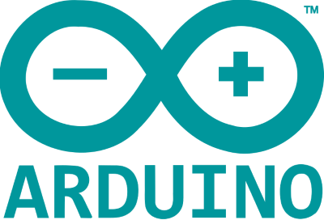
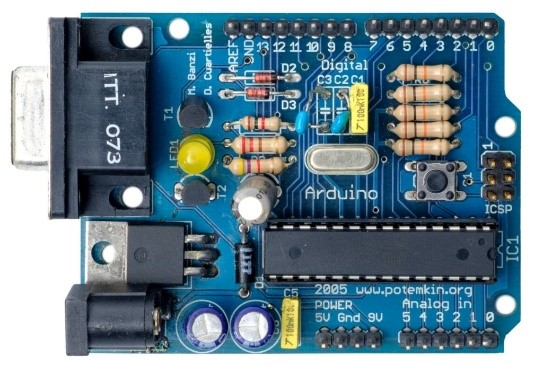
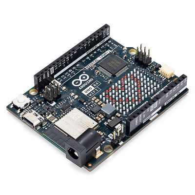
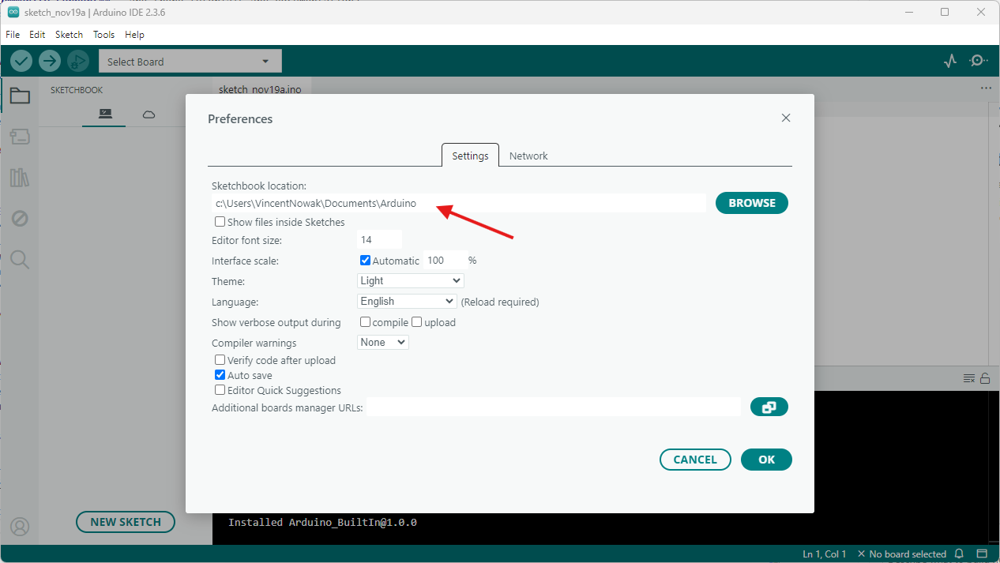
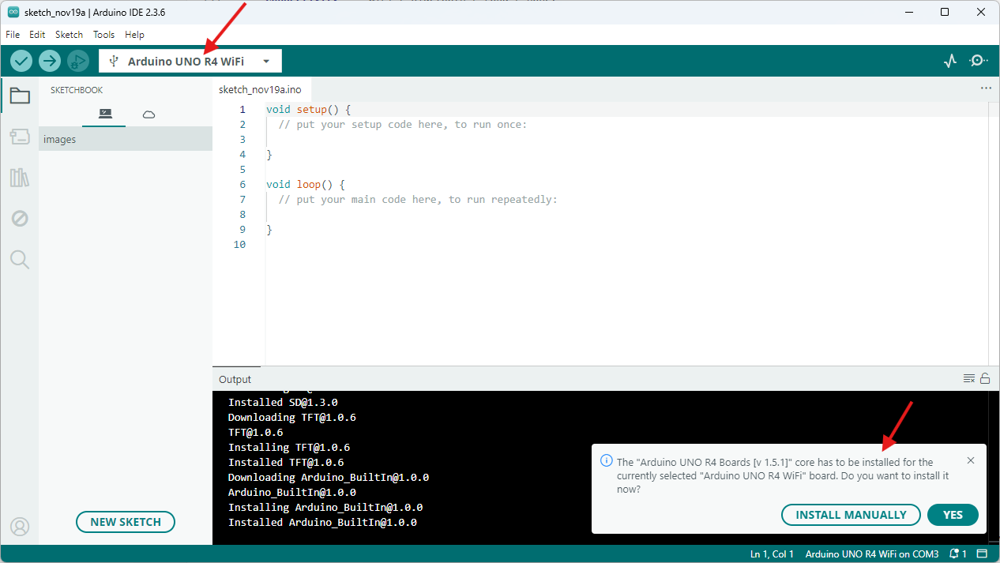
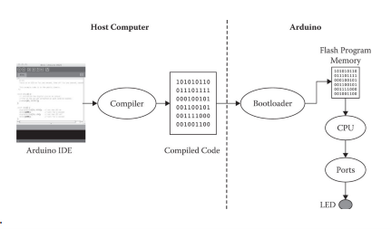

# Day 1 — Introduction to Arduino and Programming

**RC15 Skills · Prosthetic Clouds · 2026/27 · 4-hour live coding workshop**

This tutorial accompanies the live coding session. It is also a reference you can return to afterwards. We will work with an **Arduino Uno R4 WiFi** and gradually build up from a blinking LED to variables, functions, conditions, loops, arrays and communication with a computer.

**Learning outcomes:** By the end of the session, you should be able to read and modify a simple Arduino sketch, recognise the fundamental structures of C/C++, upload a program, and identify basic compilation and behavioural errors.

## 1. What is Arduino, and where does it come from?

**Arduino** is an open-source electronics platform for creating interactive projects. It combines physical boards, programming tools and a large community of shared examples and libraries.

Arduino emerged in the mid-2000s from the **Interaction Design Institute Ivrea (IDII)** in Italy. Massimo Banzi and collaborators helped develop an accessible platform for students, artists and designers who wanted to experiment with electronics without needing an engineering background. The project's open-source approach helped it spread through education, design and prototyping.


The [Bar Arduino in Ivrea](https://maps.app.goo.gl/5wCvfxTnYhPhZHdi7), which gave the project its name.



An early Arduino prototype.

[Arduino official website](https://www.arduino.cc/)

### What is programming?

A **program** is a set of instructions that tells a computer or microcontroller what to do. **Programming** means writing and organising those instructions. In this workshop we use **Arduino C/C++**.

Many interactive systems can be understood as a sequence:

**INPUT → PROCESS → OUTPUT**

For example, a sensor measures light (**input**); the program checks whether the room is dark (**process**); and an LED switches on (**output**). Today we begin with the simplest output—the built-in LED—so we can concentrate on learning the language.

### What can Arduino do?

Arduino boards can read sensors and control LEDs, motors, displays and other electronic components. They are useful for responsive objects, environmental measurements, wearable devices and physical prototypes.

### Arduino and Raspberry Pi: what is the difference?

Students may already know the Raspberry Pi, but the two devices are designed for somewhat different purposes. Here we compare our **Arduino Uno R4 WiFi** with a conventional **Raspberry Pi single-board computer**.

| Feature | Arduino Uno R4 WiFi | Raspberry Pi computer |
| --- | --- | --- |
| Type | Microcontroller board | Single-board computer |
| Operating system | No conventional operating system required for a sketch | Usually runs Linux |
| Programming | Primarily C/C++ through the Arduino environment | Python, C/C++ and many other languages |
| Operation | Runs the uploaded program directly | Runs applications through an operating system |
| Typical use | Sensors, actuators, responsive objects | Multimedia, networking, general computing |
| Power consumption | Generally lower | Generally higher |

Neither device is universally better. Some newer products also combine microcontrollers and computer-like capabilities, so the distinction is not absolute.

## 2. The Arduino language: write, compile, upload, run

An Arduino program is called a **sketch**. We write sketches in the **Arduino IDE** (*Integrated Development Environment*).

1. **Write** the sketch in the editor.
2. **Compile / Verify** it: the compiler checks the code and translates it into machine instructions.
3. **Upload** the compiled program to the board over USB.
4. **Run** it: the microcontroller executes the program. Once uploaded, it can run without the computer, provided the board has power.

**Two kinds of error:** A *compilation error* (for example, a missing semicolon) stops the sketch from compiling. A *behavioural or logic error* (for example, an incorrect delay) may compile successfully but produce the wrong result. We will encounter both.

Arduino uses C/C++ with built-in functions and libraries for interacting with hardware. You do not need to memorise the language before starting; we will introduce its syntax one element at a time.

[Arduino language reference](https://www.arduino.cc/reference/en/) · [Arduino IDE download](https://www.arduino.cc/en/software)

### The Arduino ecosystem

Arduino is open-source and supported by a broad ecosystem of compatible boards, libraries and electronic modules. Companies such as [Adafruit](https://www.adafruit.com/), [SparkFun](https://www.sparkfun.com/) and [Seeed Studio](https://www.seeedstudio.com/) provide components and documentation. For this workshop, everyone uses the same board so we can concentrate on the code.

## 3. Our board — Arduino Uno R4 WiFi



For Day 1, identify these parts of your board:

- **USB-C connector:** provides power and allows uploading sketches.
- **Microcontroller:** executes the program.
- **Digital input/output pins:** work with HIGH and LOW signals.
- **Built-in LED:** allows us to experiment without wiring an external circuit.

The Uno R4 WiFi also has analogue inputs, an LED matrix and wireless connectivity. We will explore additional hardware capabilities in Day 2. See the [official Uno R4 WiFi documentation](https://docs.arduino.cc/hardware/uno-r4-wifi/) for a pinout and complete technical information.

## 4. Installation and first connection

1. Download and install the current **Arduino IDE 2.x** from [arduino.cc/en/software](https://www.arduino.cc/en/software).
2. Connect the Uno R4 WiFi to your computer using a **USB-C data cable**.
3. In the IDE, select **Arduino Uno R4 WiFi** and the corresponding **port**. Install the Arduino UNO R4 Boards package if prompted.
4. Open **File → Examples → 01.Basics → Blink**.
5. Click **Verify** to compile, then **Upload** to transfer the sketch.
6. Observe the built-in LED blinking.



*Optional:* You can change the sketchbook location in the IDE preferences. Choose a folder you can find again.





**If upload fails:** Check that you selected the correct board and port, that the cable transfers data rather than only power, and that another program is not occupying the serial port.

---

# 5. Coding in Arduino (C/C++)

Most Arduino sketches use two special functions:

- **`setup()`** runs once when the board starts or resets.
- **`loop()`** runs repeatedly while the board is powered.

You will also see variable declarations and, later, functions that you write yourself. Work through the examples in order: each introduces a small new idea.

## 001 — Basic LED Blink

**Concept:** A program executes instructions in sequence. The `loop()` function repeats them.

```cpp
void setup() {
  pinMode(LED_BUILTIN, OUTPUT);
}

void loop() {
  digitalWrite(LED_BUILTIN, HIGH);
  delay(1000);
  digitalWrite(LED_BUILTIN, LOW);
  delay(1000);
}
```

**Read the sketch:** `pinMode()` configures the built-in LED pin as an output. `digitalWrite(..., HIGH)` switches the LED on; `LOW` switches it off. `delay(1000)` pauses execution for 1,000 milliseconds (one second). The LED remains in its current state during each delay.

| Syntax | Meaning |
| --- | --- |
| `void` | This function does not return a value |
| `()` | Contains the arguments supplied to a function |
| `{ }` | Groups instructions into a block |
| `;` | Ends a statement |
| `//` | Begins a single-line comment |
| `LED_BUILTIN`, `OUTPUT`, `HIGH`, `LOW` | Predefined names/constants |

**Try it:** (1) Change both delays to `200`. (2) Keep the LED on for `100` ms and off for `900` ms. (3) Remove a semicolon and click Verify; read the error, then restore it.

**Expected result:** The LED blinks according to the two delays. A missing semicolon produces a compilation error.

## 002 — Blink with Variables

**Concept:** A variable gives a stored value a name. The value can be used in several places and changed later.

```cpp
int pause = 1000;

void setup() {
  pinMode(LED_BUILTIN, OUTPUT);
}

void loop() {
  digitalWrite(LED_BUILTIN, HIGH);
  delay(pause);
  digitalWrite(LED_BUILTIN, LOW);
  delay(pause);
}
```

`int` means **integer** (a whole number). `pause` is the variable name, `=` assigns a value, and `1000` is the initial value. We can now change the blinking speed in one place. `=` assigns; later, `==` will compare.

```cpp
int pause = 1000;  // Declare and initialise
pause = 200;       // Assign a new value later
```

**Try it:** (1) Change `pause` to `200`. (2) Replace it with two variables, `onTime` and `offTime`, for different on/off durations. (3) As an extension, add `pause = pause + 100;` at the end of `loop()` and observe the gradual change. Reset the board to restart the program.

**Expected result:** The LED timing responds to the variable values. In the extension, the interval grows on each pass through `loop()`.

## 003 — Creating Your Own Function

**Concept:** A function is a named block of instructions that can be reused. A **parameter** receives information when the function is called.

```cpp
void setup() {
  pinMode(LED_BUILTIN, OUTPUT);
}

void loop() {
  flash(100);
  flash(500);
}

void flash(int pause) {
  digitalWrite(LED_BUILTIN, HIGH);
  delay(pause);
  digitalWrite(LED_BUILTIN, LOW);
  delay(pause);
}
```

`void flash(int pause)` **defines** the function and its parameter. `flash(100)` **calls** it with the argument `100`. After the function finishes, the program continues with the next instruction in `loop()`.

**Try it:** (1) Change the arguments. (2) Call `flash()` several times to make a rhythm. (3) Extend the function to accept two parameters: `flash(int onTime, int offTime)`, and use one for each delay.

**Expected result:** Different function calls produce different blinking rhythms without duplicating the LED instructions.

## 004 — Making Decisions with `if` and `else`

**Concept:** A condition allows the program to choose which instructions to execute.

```cpp
bool fast = true;

void setup() {
  pinMode(LED_BUILTIN, OUTPUT);
}

void loop() {
  if (fast == true) {
    flash(100);
  } else {
    flash(500);
  }
}

void flash(int pause) {
  digitalWrite(LED_BUILTIN, HIGH);
  delay(pause);
  digitalWrite(LED_BUILTIN, LOW);
  delay(pause);
}
```

A `bool` stores either `true` or `false`. `if` checks a condition; `else` supplies the alternative. **`==` compares values**, while **`=` assigns a value**. For example, `fast == true` asks whether `fast` is true.

**Try it:** (1) Change `fast` to `false`. (2) Use `int speed = 300;` and `if (speed < 200)` to choose a pattern. (3) Add `else if` for a third speed.

**Expected result:** The program follows the branch selected by the condition. In Day 2, conditions can respond to sensor measurements rather than a preset variable.

## 005 — Repetition with `for` Loops

**Concept:** A `for` loop repeats a block of instructions according to a counter and condition. It is different from Arduino's special `loop()` function, which repeats the whole main program.

```cpp
void setup() {
  pinMode(LED_BUILTIN, OUTPUT);
}

void loop() {
  for (int i = 0; i < 10; i = i + 1) {
    flash(100);
  }

  delay(2000);
}

void flash(int pause) {
  digitalWrite(LED_BUILTIN, HIGH);
  delay(pause);
  digitalWrite(LED_BUILTIN, LOW);
  delay(pause);
}
```

Read the three parts of `for (int i = 0; i < 10; i = i + 1)`:

1. **Start:** create counter `i` with value `0`.
2. **Condition:** repeat while `i < 10`.
3. **Update:** increase `i` by one after each repetition.

The counter takes the values **0 through 9**: that is ten repetitions. After the ten flashes, the program waits two seconds and starts the sequence again.

**Try it:** (1) Change the limit to `5`. (2) Change the increment to `i = i + 2`; how many flashes occur? (3) Replace `flash(100)` with `flash(50 + i * 50)` to make the flashes progressively slower.

**Expected result:** A burst of flashes followed by a two-second pause, repeated continuously.

## 006 — Arrays: Storing Several Values

**Concept:** An **array** stores several values of the same type under one name. Each value has an **index**, starting at zero.

```cpp
int timings[] = {200, 40, 50, 500, 70};

void setup() {
  pinMode(LED_BUILTIN, OUTPUT);
}

void loop() {
  for (int i = 0; i < 5; i++) {
    flash(timings[i]);
  }

  delay(2000);
}

void flash(int pause) {
  digitalWrite(LED_BUILTIN, HIGH);
  delay(pause);
  digitalWrite(LED_BUILTIN, LOW);
  delay(pause);
}
```

| Index | `0` | `1` | `2` | `3` | `4` |
| --- | --- | --- | --- | --- | --- |
| Value (ms) | 200 | 40 | 50 | 500 | 70 |

`timings[0]` is `200`; `timings[3]` is `500`. The loop counter `i` selects each array element in turn. **Do not access `timings[5]`:** this array has no element at index 5, and out-of-bounds access can cause unpredictable behaviour even when code compiles.

**Try it:** (1) Change the values to make your own rhythm. (2) Add a sixth value and update the loop limit. (3) Reverse the order of the values.

**Expected result:** Five different flash durations are played in sequence, followed by a pause.

## 007 — Sending Data to the Computer

**Concept:** **Serial communication** allows the Arduino to send information to your computer. The **Serial Monitor** in the IDE displays it. This is also a useful debugging tool.

```cpp
void setup() {
  Serial.begin(9600);
}

void loop() {
  Serial.println("Hello from Arduino!");
  delay(1000);
}
```

`Serial.begin(9600)` starts communication at **9600 baud**. `Serial.print()` sends text without adding a new line; `Serial.println()` adds a new line. Open **Tools → Serial Monitor** (or the Serial Monitor panel) and check that its baud rate matches the sketch.

**Try it:** (1) Change the message. (2) Print a variable. (3) Print the value of `i` inside a `for` loop. Combine `Serial.print()` and `Serial.println()` to show labels and values.

**Expected result:** The computer displays the text or numbers sent by the Arduino. You can use this to inspect values while a program runs.

## 008 — Receiving Commands from the Computer

**Concept:** Serial communication also works in the other direction: the computer can send a command to the Arduino.

```cpp
void setup() {
  Serial.begin(9600);
  pinMode(LED_BUILTIN, OUTPUT);
}

void loop() {
  if (Serial.available() > 0) {
    char command = Serial.read();

    if (command == '1') {
      digitalWrite(LED_BUILTIN, HIGH);
      Serial.println("LED ON");
    } else if (command == '0') {
      digitalWrite(LED_BUILTIN, LOW);
      Serial.println("LED OFF");
    }
  }
}
```

`Serial.available()` checks whether incoming data is waiting. `Serial.read()` reads one byte. Here we store it in a `char`, which represents a character. **`'1'` is a character, not the integer `1`**. Type `1` or `0` into the Serial Monitor's input field and send it. Set the line-ending option to **No line ending** for the simplest behaviour.

**Try it:** (1) Switch the LED on and off from the computer. (2) Add a command `'b'` that flashes the LED three times. (3) Print a message when an unrecognised command is received.

**Expected result:** The Arduino responds to typed commands and confirms its actions in the Serial Monitor.

---

# 6. Further Reading and Reference

## Technical specifications — Arduino Uno R4 WiFi

| Feature | Specification |
| --- | --- |
| Main microcontroller | Renesas RA4M1, Arm Cortex-M4, 48 MHz |
| Flash program memory | 256 KB |
| SRAM | 32 KB |
| Data EEPROM | 8 KB |
| Main microcontroller logic | 5 V |
| Wireless connectivity | ESP32-S3 module supporting Wi-Fi and Bluetooth LE |
| Digital I/O | 14 pins (including PWM-capable pins) |
| Analogue inputs | 6 |
| Built-in LED matrix | 12 × 8 |
| USB | USB-C |
| Additional connections | Qwiic I²C connector, power and expansion headers |

The Uno R4 WiFi is a capable general-purpose development board, although it is comparatively large for some wearable applications. Always consult the [official board documentation](https://docs.arduino.cc/hardware/uno-r4-wifi/) for electrical limits and wiring guidance.

### Data types and memory

| Type | Example | Purpose |
| --- | --- | --- |
| `bool` | `true` | True/false condition |
| `char` | `'A'` | Single character |
| `int` | `42` | Whole number |
| `float` | `3.14` | Number with a decimal part |

**Flash** stores the uploaded program, **RAM** holds values used while the program runs, and **EEPROM** provides non-volatile data storage. The exact memory size of a data type can vary by board; use the official documentation when it matters.

## Choosing another board

For later prototypes, consider:

- **Size and weight:** Does it fit into the object or wearable?
- **Power:** USB, battery or external supply?
- **Connectivity:** Do you need Wi-Fi, Bluetooth or another protocol?
- **Inputs and outputs:** How many sensors and actuators are needed?
- **Documentation:** Are there reliable libraries, examples and community support?

### Adafruit Feather

Compact boards with different processor and wireless options, often well suited to battery-powered and wearable projects. See the [Feather family guide](https://learn.adafruit.com/adafruit-feather/feather-family).

### ESP8266 / NodeMCU

Low-cost Wi-Fi-capable microcontroller boards with a substantial ecosystem of examples. Check voltage requirements and the features of the particular variant.

### Arduino Mega / Giga

Larger boards with many more connections, useful for prototypes involving numerous inputs and outputs. They are generally less suitable where size is critical.

## Optional extension — Receiving text messages

The main session introduces single-character commands. A later experiment could receive a full word or sentence over Serial. This requires considering strings, line endings and how incoming data is buffered; it is not required to understand today's eight core examples.

---

**End of Day 1.** You have written and modified programs using variables, functions, conditions, loops, arrays and serial communication. In **Day 2**, these programming concepts will be used to connect sensors and actuators to the physical world.
