# Day 2 — Building a Modular Data Logger

**RC15 Skills · Prosthetic Clouds · 2026/27 · 4-hour practical workshop**

On Day 1, we learned how to write Arduino programs. Today we use those skills to build a device that measures **skin conductance (GSR)**, receives **GPS location and time**, and stores observations on an **SD card**. We will first test each component independently, then combine the hardware and code into one data logger.

> **The central idea: modularity.** Each component has a particular job. Test each part on its own, understand how it communicates, and only then assemble the complete system. This applies to both hardware and software.

## Learning outcomes

By the end of the session, you should be able to:

- Connect and test a sensor, a GPS receiver and an SD card module.
- Distinguish **analogue readings**, **UART**, **SPI** and **I²C**.
- Explain how text data is formatted using delimiters, line endings and escape characters.
- Save structured observations to a **CSV** file and inspect the results on a computer.
- Organise a larger sketch into functions, test its modules and troubleshoot the integrated device.

## The system we are building

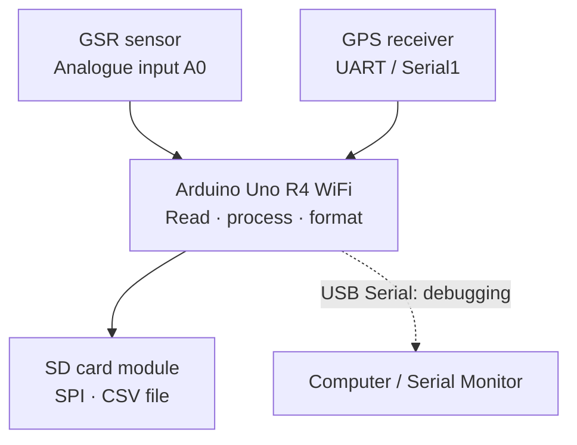

**Hardware:** Arduino Uno R4 WiFi; Grove GSR sensor; GPS receiver; compatible SD card shield/module and microSD card; appropriate connectors and a USB-C **data** cable. Check the voltage requirements and pin assignments of your specific modules before connecting them. Disconnect power before changing wiring.

**Software:** Arduino IDE 2.x; **TinyGPS++** library for GPS; built-in **SPI** and **SD** libraries. Install TinyGPS++ using the IDE's Library Manager.

## How the four exercises build up

| Exercise | Hardware | New ideas | Result |
| --- | --- | --- | --- |
| **001 — GSR** | GSR → Arduino | Analogue input, resolution, averaging | A stream of sensor readings |
| **002 — GPS** | GPS → Arduino | UART, baud rate, NMEA, libraries | Position and time on Serial Monitor |
| **003 — SD card** | Arduino → SD | SPI, file operations, CSV, escape characters | A readable data file |
| **004 — Integration** | GSR + GPS + SD | Functions, shared data, recording strategy | A working portable data logger |

---

# 001 — Reading the GSR Sensor

## What is GSR?

**Galvanic Skin Response (GSR)** refers to changes in the electrical conductance of skin, influenced partly by sweat gland activity. A GSR sensor measures an electrical response; it **does not directly measure an emotion**. Interpretation requires context, careful calibration and consideration of movement, contact and individual variation.

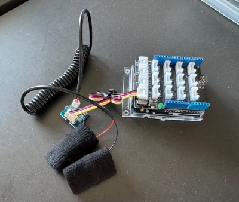

[Seeed Studio Grove GSR documentation](https://wiki.seeedstudio.com/Grove-GSR_Sensor/)

## Connect the sensor

Connect the sensor's analogue output to **A0** and its power and ground connections as specified in the manufacturer's documentation. If using a Grove adapter, make sure the socket provides an **analogue** signal. Do not assume that connectors with similar shapes carry the same signals.

### Analogue versus digital

A digital input usually distinguishes states such as HIGH and LOW. An **analogue input** measures a varying voltage and converts it into a number using an analogue-to-digital converter (ADC).

On the Uno R4 WiFi, `analogRead()` defaults to **10-bit compatibility mode**, producing values from **0 to 1023**. You can request other supported resolutions with `analogReadResolution()`; for example, 12 bits gives **0 to 4095**. The number is an ADC reading, **not a direct physical measurement of emotion or skin conductance in calibrated units**.

## First test — one reading at a time

```cpp
const int GSR_PIN = A0;

void setup() {
  Serial.begin(9600);
}

void loop() {
  int reading = analogRead(GSR_PIN);
  Serial.println(reading);
  delay(100);
}
```

Open the **Serial Monitor** at 9600 baud. Observe how the readings change when the electrodes make contact with the skin. Try the Serial Plotter to see the values over time.

**From Day 1:** This sketch reuses variables, `setup()`, `loop()` and `Serial.println()`.

## Averaging several readings

Individual readings can fluctuate. Averaging a group of readings can reduce some short-term noise.

```cpp
const int GSR_PIN = A0;

void setup() {
  Serial.begin(9600);
}

void loop() {
  long sum = 0;

  for (int i = 0; i < 50; i++) {
    sum += analogRead(GSR_PIN);
    delay(5);
  }

  int average = sum / 50;
  Serial.println(average);
}
```

**Read the code:** `for` repeats the measurement 50 times. `sum += value` is shorthand for `sum = sum + value`. The `long` type gives the running total more room than a small integer. Dividing by 50 gives the arithmetic mean. Because we pause 5 ms between readings, this sampling step takes **at least 250 ms**, plus processing time.

**Try it:** Compare raw and averaged readings; change the number of samples; experiment with `analogReadResolution(12)` in `setup()` and observe the different numerical range.

**Expected result:** A changing number that responds to the sensor, with a smoother output when averaging. Do not treat the raw values as clinically meaningful.

---

# 002 — Reading the GPS Receiver

## What does GPS provide?

A GPS receiver listens to satellite signals to estimate **location and time**. It does not transmit your position to the satellites. A clear view of the sky is often needed for a reliable fix, and the first fix may take several minutes.

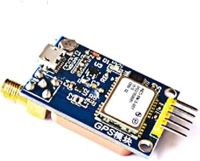

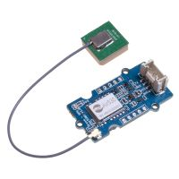

## Communication concept — UART

The GSR sensor sends a varying **analogue voltage**. A GPS module usually sends **digital data over UART** (*Universal Asynchronous Receiver/Transmitter*).

- **TX** means transmit; **RX** means receive. The module's **TX** normally connects to the Arduino's **RX**.
- Both ends must agree on a **baud rate**, such as 9600.
- UART sends a sequence of bytes. A GPS receiver commonly sends readable **NMEA sentences**, which contain fields for location, time and other information.
- On the **Uno R4 WiFi**, `Serial` communicates with the computer over USB, while `Serial1` uses the board's hardware UART pins for the external GPS module.

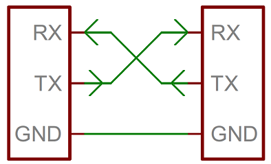

**Important:** UART is the communication interface. USB Serial is a separate USB connection presented through the Arduino programming environment. The two are convenient to use together, but they are not identical electrical interfaces. Check module voltage levels before wiring.

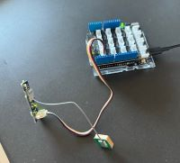

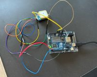

The exact wiring depends on your module. Confirm its **VCC**, **GND**, **TX** and **RX** labels and required supply voltage.

## Why use a library?

GPS modules send text sentences that must be interpreted. We could write our own parser, but that would distract from today's task. **TinyGPS++** turns the incoming stream into accessible values such as latitude, longitude and time.

Install **TinyGPS++** using **Sketch → Include Library → Manage Libraries** in the Arduino IDE.

[TinyGPS++ documentation](http://arduiniana.org/libraries/tinygpsplus/)

## GPS test sketch

```cpp
#include <TinyGPS++.h>

TinyGPSPlus gps;

void setup() {
  Serial.begin(9600);   // Computer / Serial Monitor
  Serial1.begin(9600);  // GPS receiver
  Serial.println("Waiting for GPS data...");
}

void loop() {
  while (Serial1.available() > 0) {
    gps.encode(Serial1.read());
  }

  if (gps.location.isUpdated() && gps.location.isValid()) {
    Serial.print("Latitude: ");
    Serial.println(gps.location.lat(), 6);

    Serial.print("Longitude: ");
    Serial.println(gps.location.lng(), 6);

    if (gps.date.isValid() && gps.time.isValid()) {
      Serial.print("UTC date: ");
      Serial.print(gps.date.value());
      Serial.print("  UTC time: ");
      Serial.println(gps.time.value());
    }

    Serial.println("---");
  }
}
```

**Read the code:** `#include` makes a library available. `while (Serial1.available() > 0)` reads all currently waiting bytes. `gps.encode()` passes each byte to the parser. `isUpdated()` indicates a new location update; `isValid()` guards against using an invalid location. The date and time supplied by GPS are **UTC**, not necessarily local time.

**Try it:** Identify which statements read raw data and which display parsed values. Take the module outside if it cannot obtain a fix indoors. Compare readings in different locations.

**Expected result:** When a valid fix becomes available, latitude and longitude appear in the Serial Monitor. No fix means no location output; that is not automatically a programming error.

---

# 003 — Writing Structured Data to an SD Card

## Communication concept — SPI

An SD card module commonly communicates using **SPI** (*Serial Peripheral Interface*). Unlike UART, SPI uses a shared clock and separate data lines:

- **SCK:** clock signal.
- **MOSI:** data sent from the controller to the device.
- **MISO:** data sent from the device to the controller.
- **CS / SS:** chip select, used to choose a particular device.

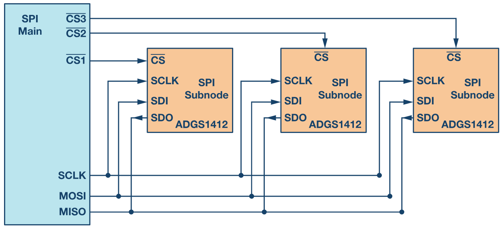

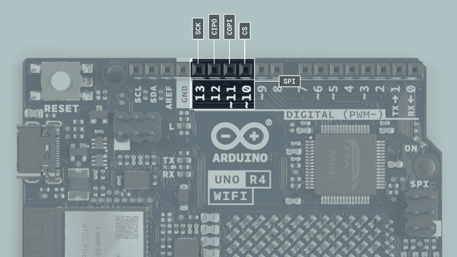

On the Uno R4 WiFi, SPI signals are available through the board's SPI connections; compatible shields often use the **ICSP header**. The **CS pin depends on the shield**. The example below uses **D4**, matching the Seeed SD Card Shield V4.0 configuration shown in the existing workshop material. **Verify the actual shield's CS setting before running the sketch.**

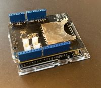

[Seeed SD Card Shield V4.0 reference](https://wiki.seeedstudio.com/SD_Card_Shield_V4.0/)

### A brief comparison of the three communication protocols

| Protocol | Connections | Typical use in this workshop |
| --- | --- | --- |
| **UART** | TX, RX, GND (plus power) | GPS receiver |
| **SPI** | SCK, MOSI, MISO, CS (plus power) | SD card |
| **I²C** | SDA, SCL (plus power and ground) | Many small sensors and displays; not required for our logger |

**I²C** lets multiple addressed devices share the same two signal lines. The Uno R4 WiFi also provides a **Qwiic connector** for I²C modules. Qwiic and STEMMA QT are connector ecosystems, not separate communication protocols; **Grove** connectors can carry analogue, digital, UART or I²C signals depending on the module. The physical connector alone does not tell you which protocol is used.

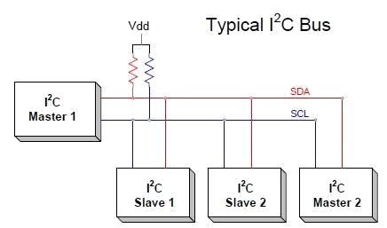

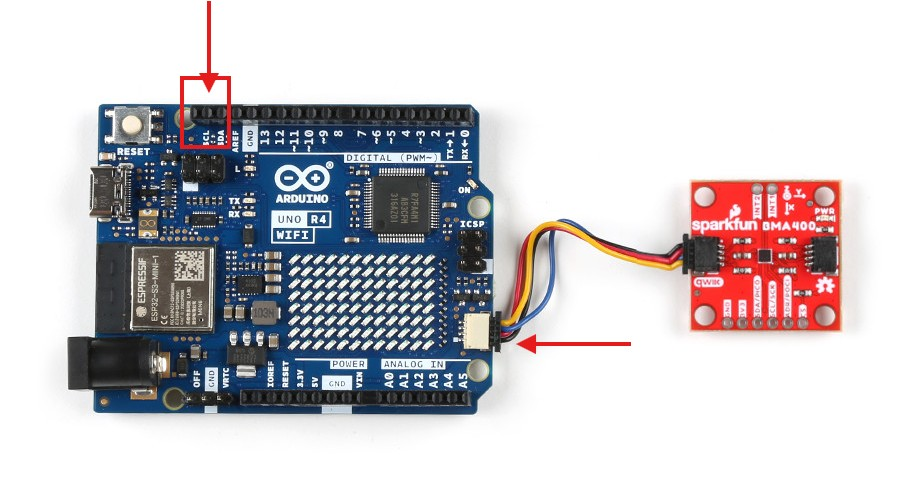

References: [SparkFun Qwiic](https://www.sparkfun.com/qwiic) · [Adafruit STEMMA QT](https://www.adafruit.com/category/1005) · [Seeed Grove](https://wiki.seeedstudio.com/Grove_System/)

## What is a CSV file?

**CSV** means *comma-separated values*. It is a plain-text format for storing tables. Each **line** represents one record, and each **comma** separates fields.

```csv
index,latitude,longitude,gsr
0,51.540530,-0.043872,456
1,51.540531,-0.043870,455
```

The first line is a **header** that names the columns. A CSV file can be opened in a text editor, Excel, Python or other data-analysis tools. A tab-separated file is normally called **TSV**, not CSV. We will use commas consistently.

**Important distinction:** In general CSV, fields containing commas, quotation marks or line breaks need special quoting rules. Our logger writes numeric values with no embedded commas, so we can use straightforward comma-separated output.

## Strings and escape characters

Arduino text is often represented by a string in double quotation marks. Some characters have special meanings inside strings:

| Code | Meaning | Example use |
| --- | --- | --- |
| `\n` | New line | Start another line of text |
| `\r` | Carriage return | Part of some line-ending conventions |
| `\t` | Tab | Align debug text or create TSV |
| `\"` | Literal double quote | Put a quotation mark inside text |
| `\\` | Literal backslash | Display a backslash character |

For example:

```cpp
Serial.print("Latitude:\t");
Serial.println(51.540530, 6);
```

`Serial.print()` does **not** add a line ending; `Serial.println()` does. You can build a CSV row by printing several values with commas between them, then ending the row with `println()`.

## Prepare the card

Use a card formatted with a filesystem supported by the **SD library**, typically **FAT16 or FAT32**. Many newer or larger cards arrive formatted as exFAT and may not work with this library. Formatting **erases the card**, so back up its contents first. Check the format with your operating system or an appropriate formatting tool.

## First SD card sketch

```cpp
#include <SPI.h>
#include <SD.h>

const int CHIP_SELECT = 4;  // Confirm this for your shield
int recordNumber = 0;

void setup() {
  Serial.begin(9600);

  if (!SD.begin(CHIP_SELECT)) {
    Serial.println("SD initialisation failed.");
    while (true) {
      delay(100);
    }
  }

  // Remove the previous test file so this example starts fresh.
  // Do NOT do this if you need to preserve earlier measurements.
  SD.remove("TEST.CSV");

  File file = SD.open("TEST.CSV", FILE_WRITE);
  if (file) {
    file.println("index,value");
    file.close();
  } else {
    Serial.println("Could not create TEST.CSV");
  }
}

void loop() {
  File file = SD.open("TEST.CSV", FILE_WRITE);

  if (file) {
    file.print(recordNumber);
    file.print(",");
    file.println(recordNumber * 10);
    file.close();

    Serial.println("Saved one record.");
  } else {
    Serial.println("Could not open TEST.CSV");
  }

  recordNumber++;
  delay(1000);
}
```

**Read the code:** `SD.begin()` initialises the card; `SD.open()` opens or creates a file; `file.print()` writes data; `file.println()` finishes the row; `file.close()` ensures the file is closed after writing. The example uses a short **8.3 filename** for broad compatibility.

**Try it:** Let the logger run for ten seconds, power down safely, remove the card and open `TEST.CSV` on your computer. Explain which line is the header and which lines are data. Add a third numeric column.

**Expected result:** A CSV file containing a header and an increasing sequence of records.

---

# 004 — Assemble the Modular Data Logger

Now combine the three tested subsystems:

1. **GSR:** read and average the analogue signal.
2. **GPS:** receive and parse location and UTC time.
3. **SD:** write one complete record as CSV.

The key programming technique is to give each responsibility a **function**. That makes the larger sketch easier to read and debug.

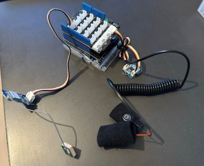

## How often should we record?

GSR can be sampled many times per second, while GPS updates at its own rate. For this first integrated version, **a new valid GPS location update triggers one CSV record**. At that moment we take a short average of GSR readings and save it alongside the location and GPS time.

This is a deliberate simplification. It means there will be **no new record without a GPS fix**, and the sample intervals depend on the GPS update rate. Later you could design a logger with a separate fixed sampling interval or a fallback when GPS is unavailable.

## Complete integrated sketch

```cpp
#include <TinyGPS++.h>
#include <SPI.h>
#include <SD.h>

const int GSR_PIN = A0;
const int CHIP_SELECT = 4;  // Check your SD shield
const char FILE_NAME[] = "DATA.CSV";

TinyGPSPlus gps;
unsigned long recordNumber = 0;

int readGSR() {
  long sum = 0;

  for (int i = 0; i < 10; i++) {
    sum += analogRead(GSR_PIN);
    delay(5);
  }

  return sum / 10;
}

void readGPS() {
  while (Serial1.available() > 0) {
    gps.encode(Serial1.read());
  }
}

bool saveData(unsigned long index, double latitude, double longitude,
              unsigned long date, unsigned long time, int gsr) {
  File file = SD.open(FILE_NAME, FILE_WRITE);

  if (!file) {
    return false;
  }

  file.print(index);
  file.print(",");
  file.print(latitude, 6);
  file.print(",");
  file.print(longitude, 6);
  file.print(",");
  file.print(date);
  file.print(",");
  file.print(time);
  file.print(",");
  file.println(gsr);
  file.close();

  return true;
}

void setup() {
  Serial.begin(9600);   // Computer
  Serial1.begin(9600);  // GPS

  if (!SD.begin(CHIP_SELECT)) {
    Serial.println("SD initialisation failed.");
    while (true) {
      delay(100);
    }
  }

  // Append to the existing file if it is already present.
  // Only write the header when creating a new file.
  if (!SD.exists(FILE_NAME)) {
    File file = SD.open(FILE_NAME, FILE_WRITE);
    if (file) {
      file.println("index,latitude,longitude,date_utc,time_utc,gsr");
      file.close();
    } else {
      Serial.println("Could not create data file.");
    }
  }

  Serial.println("Logger ready. Waiting for GPS fix...");
}

void loop() {
  readGPS();

  if (gps.location.isUpdated() && gps.location.isValid()
      && gps.date.isValid() && gps.time.isValid()) {

    int gsr = readGSR();

    bool saved = saveData(
      recordNumber,
      gps.location.lat(),
      gps.location.lng(),
      gps.date.value(),
      gps.time.value(),
      gsr
    );

    if (saved) {
      Serial.print("Saved record ");
      Serial.println(recordNumber);
      recordNumber++;
    } else {
      Serial.println("Error writing data record.");
    }
  }
}
```

### Read the structure, not just the individual lines

- **`readGSR()`** owns the analogue sensor and returns an averaged value.
- **`readGPS()`** feeds incoming bytes to the GPS parser.
- **`saveData()`** owns the CSV formatting and SD card file operations. It returns `true` or `false` to indicate whether a file was opened and written.
- **`setup()`** initialises the communication channels and SD card.
- **`loop()`** coordinates the modules and decides when to create a record.

This is **software modularity**: the program's parts correspond to the hardware's responsibilities. Notice that the sketch also reuses Day 1 concepts: functions, variables, conditions, loops and Serial output.

### Example output

```csv
index,latitude,longitude,date_utc,time_utc,gsr
0,51.540530,-0.043872,271024,16540400,456
1,51.540531,-0.043870,271024,16540500,455
```

The numbers above are **illustrative**, not live measurements. `date_utc` and `time_utc` are the raw numeric formats returned by TinyGPS++ (`ddmmyy` and `hhmmsscc`, respectively). They are not ISO 8601 timestamps; converting them is a possible later improvement.

**A limitation to understand:** While `readGSR()` performs ten readings with delays, incoming GPS bytes may continue arriving. The UART buffer normally absorbs short gaps, but longer blocking operations can lose data. This is one reason advanced loggers use non-blocking timing and more deliberate sampling strategies.

## Testing the integrated device

Work through the modules in order rather than changing everything at once:

| Symptom | Check first |
| --- | --- |
| No GSR readings | Sensor power, ground, analogue output and A0 |
| No GPS position | Module wiring, TX/RX, baud rate and sky visibility |
| SD initialisation fails | Card format, CS pin, shield connection and card insertion |
| CSV has only a header | GPS may not have a valid fix; check Serial Monitor |
| Unexpected column layout | Count commas, inspect line endings and open the file in a text editor |
| Intermittent failure after assembly | Power supply, loose connections and shared ground |

**Try it:** Collect a short dataset; open it as text and in a spreadsheet; plot the GSR values against the record index; discuss what additional information would be necessary to interpret the measurements responsibly.

**Expected result:** A single CSV file containing one row per accepted GPS update, with location, GPS date/time and an averaged GSR reading.

---

# Further Reading and Extensions

These topics are valuable for future projects but are **not additional mandatory builds** during the four-hour session.

## Wireless communication

The Uno R4 WiFi combines a **Renesas RA4M1** main microcontroller with an **ESP32-S3** connectivity module. Wi-Fi can be used for dashboards or transmitting data to another computer; Bluetooth Low Energy can connect to compatible devices. Wireless communication introduces additional questions of pairing, network reliability, power use and data privacy. Consult the [official Uno R4 WiFi documentation](https://docs.arduino.cc/hardware/uno-r4-wifi/) before designing around a particular wireless feature.

## Grove, Qwiic and STEMMA QT

These connector systems simplify prototyping, but **they do not replace understanding the signal type and voltage**. Grove can carry different interfaces; Qwiic/STEMMA QT generally use I²C. Always check the module's documentation and the voltage supplied by the connector.

## Servo motor — an actuator example

The logger primarily **senses and records**. An actuator performs a physical action in response to a program. For example, a small servo can rotate a pointer to represent a sensor value.

```cpp
#include <Servo.h>

Servo myServo;

void setup() {
  myServo.attach(9);
}

void loop() {
  for (int angle = 0; angle <= 180; angle++) {
    myServo.write(angle);
    delay(15);
  }

  for (int angle = 180; angle >= 0; angle--) {
    myServo.write(angle);
    delay(15);
  }
}
```

Use a suitable power supply for the servo. Motors can draw more current than the Arduino can safely provide; an external supply with a **common ground** may be necessary. Check the servo's permitted rotation range and wiring.

## Next steps

Possible extensions include recording at a fixed time interval, converting timestamps to ISO 8601, detecting missing GPS fixes, writing data without blocking delays, adding more sensors over I²C, transmitting readings wirelessly, and using the CSV data in Python, QGIS or Rhino/Grasshopper.

**Day 3** will explore how to specify and develop these more complex behaviours with AI assistance—while retaining the ability to test the hardware, read the code and judge whether the result works.