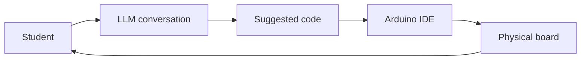
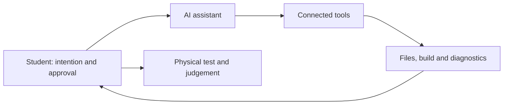

# Day 3 — AI-Assisted Arduino Programming

**RC15 Skills · Prosthetic Clouds · 2026/27 · Four-hour workshop**

On Day 1, we learned to read and write Arduino code. On Day 2, we built a modular GSR/GPS/SD data logger. Today we use a large language model (LLM) to explore programmable light and extend an existing system.

**The objective is not to avoid programming. It is to develop stronger ideas, clearer specifications and better judgement about the code we create.**

We begin with the Arduino Uno R4 WiFi's **built-in 12 × 8 LED matrix**, then return to the Day 2 logger. No external LED hardware is required today.

## Learning outcomes

- Discuss a technical and visual idea with an LLM **before requesting code**.
- Turn an intention into a testable specification.
- Generate, inspect, upload and refine Arduino sketches.
- Develop patterns, animations and communication behaviours using the onboard matrix.
- Understand possibilities for external LED arrays and LEDs integrated into textiles.
- Modify the Day 2 logger while preserving its modular organisation.
- Distinguish ordinary chat, tool calling, agents and MCP.

## Workshop structure

| Time | Exercise | Outcome |
| --- | --- | --- |
| 00:00–00:30 | **001 — AI as a programming collaborator** | Think, discuss and specify |
| 00:30–01:15 | **002 — LED matrix experiments** | A working animated pattern |
| 01:15–02:00 | **003 — From prompt to working behaviour** | A refined visual language |
| 02:00–03:30 | **004 — Modify the Day 2 data logger** | One tested new capability |
| 03:30–04:00 | **005 — Agents, MCP and reflection** | Understand further possibilities and limitations |

**Bring:** Arduino Uno R4 WiFi, USB-C data cable, computer with Arduino IDE 2.x, and access to an LLM. For Exercise 004, bring the Day 2 logger components (GSR sensor, GPS receiver and SD module) where available.

---

# 001 — AI as a Programming Collaborator

## Think → Discuss → Specify → Code → Test → Reflect

An LLM can generate code quickly. But compiling successfully does not mean a program behaves as intended.

1. **Think:** What do you want the device to do? Sketch the behaviour.
2. **Discuss:** Ask the LLM about alternative approaches, assumptions and constraints.
3. **Specify:** Define the board, inputs, outputs, timing and criteria for success.
4. **Code:** Request a small working version before adding complexity.
5. **Test:** Upload to the *physical* Arduino and observe the result.
6. **Reflect:** Compare intention with observation and decide what to change.

**Rule for the opening conversation:** Do not request code yet. First explore the problem and its possibilities.

### Example conversation

> I am using an Arduino Uno R4 WiFi with its built-in 12 × 8 LED matrix. I want to create a moving light pattern that feels like a wave travelling across a surface. Before writing code, help me explore three possible visual behaviours. Explain how each might work, which parameters I could control, and how I could test the result on the board.

Notice that this establishes the **hardware**, **creative intention** and **stage of work**.

### Keep your judgement

LLMs may invent library functions, confuse Arduino boards or propose hardware that is not connected. Verify unfamiliar claims using the board documentation and library examples. Treat generated code as a proposal, not as an authority.

---

# 002 — LED Matrix Experiments

## A small canvas for programmable light

The Arduino Uno R4 WiFi has a small LED matrix built directly into the board. It consists of **96 LEDs arranged in 12 columns and 8 rows**. Think of it as a tiny screen in which every LED represents one pixel. Unlike a conventional colour display, each pixel is simply illuminated or switched off.

The Arduino controls the matrix through a program. We can define which LEDs should be illuminated to create a **frame**—a single image or pattern. By displaying different frames in quick succession, we create the impression of movement. Alternatively, we can use mathematical rules to generate changing patterns, such as waves, pulses or randomly moving points.

The matrix is controlled using the **`Arduino_LED_Matrix` library**, which provides functions for displaying patterns and animations. We do not need to control the individual electrical connections ourselves. Instead, we can concentrate on designing the visual behaviour.

Although the resolution is limited, the matrix is an excellent starting point for exploring how light can communicate through **position, rhythm, repetition, density and movement**.

References: [Arduino Uno R4 WiFi](https://docs.arduino.cc/hardware/uno-r4-wifi/) · [Arduino LED matrix tutorial](https://docs.arduino.cc/tutorials/uno-r4-wifi/led-matrix/).

## Verify the hardware first

In the Arduino IDE, select **Arduino Uno R4 WiFi**, open an LED matrix example and upload it. Check that the display works before introducing AI-generated code.

A minimal static frame example:

```cpp
#include <Arduino_LED_Matrix.h>

ArduinoLEDMatrix matrix;

const uint32_t frame[] = {
  0x00000000,
  0x00F00F00,
  0x00000000
};

void setup() {
  matrix.begin();
  matrix.loadFrame(frame);
}

void loop() {
}
```

The frame uses the library's packed representation of 12 × 8 pixels. The [Arduino LED matrix editor](https://ledmatrix-editor.arduino.cc/) and official examples help explain how frames are constructed. Ask the LLM to explain the representation it uses.

## Exercise A — Describe a visual idea

Choose or invent a behaviour:

- A pulse travelling from one edge to another.
- Ripples expanding from a point.
- A constellation of flickering points.
- A transition between order and randomness.
- A simple symbol or pattern representing a message.

**Before generating code**, ask the LLM for three interpretations. Select one, then agree on direction, duration, speed and repetition. Request a minimal sketch for the **Uno R4 WiFi onboard matrix** and upload it.

**Outcome:** A working pattern you can explain and demonstrate.

## Exercise B — Make the pattern more expressive

Treat the LED matrix as a tiny design surface. Explore:

- **Rhythm:** steady, irregular, accelerating or slowing pulses.
- **Movement:** diagonals, waves, rotation, travelling points.
- **Density:** sparse, clustered or dispersed pixels.
- **Transformation:** growth, fragmentation, merging or disappearance.
- **Communication:** a pattern associated with a recognisable state.

Ask the LLM to make useful parameters easy to change, such as `speed`, `density` and `direction`. Change one parameter at a time.

### Frame-by-frame versus procedural animation

A **frame-by-frame** animation displays predefined images in sequence. A **procedural** animation calculates pixel states from rules or equations.

Which is better for your design? Stored frames may be suitable for a repeated icon; procedural approaches may better suit evolving waves or generative patterns.

**Challenge:** Can a few simple rules produce a visually rich behaviour?

---

# 003 — From Prompt to Working Behaviour

## Design a visual language

Imagine your Arduino needs to communicate three states without text:

1. **Ready:** powered on and waiting.
2. **Recording:** actively collecting information.
3. **Attention:** something requires a response.

Design a distinct animation for each. Think about recognisability, not simply visual complexity.

### Step 1 — Specify

| Question | Example |
| --- | --- |
| Hardware? | Uno R4 WiFi onboard 12 × 8 matrix |
| States? | Ready, recording, attention |
| Visual behaviours? | Slow pulse, travelling line, repeating alert |
| Adjustable parameters? | Speed, repetition, spatial distribution |
| Test? | Can another student distinguish the three states? |

### Step 2 — Generate and inspect

Ask for a sketch organised into small functions, for example `showReady()`, `showRecording()` and `showAttention()`. Request comments explaining the visual logic. Check that the generated code uses the correct board and matrix library.

### Step 3 — Observe and refine

Upload the sketch. Describe **what actually happened** to the LLM. A photo or short video can help. Request focused revisions: for example, “Keep the recording animation but make the movement less regular.”

### Step 4 — Document

Save the sketch and record:

- The original visual intention.
- The main changes made during your conversation.
- One decision **you** made.
- One limitation or unresolved question.

## Beyond the Onboard Matrix — Light as a Material and Communication Medium

**This is a discussion chapter, not an additional hardware exercise.** Today we only program the onboard matrix. The same ideas can, however, extend to much larger, coloured and spatially distributed systems.

### External LED matrices and strips

Commercially available matrices and individually addressable RGB strips (such as WS2812-family devices) offer colour, more pixels and flexible physical arrangements. They can create gradients, travelling signals, distributed animations and generative fields.

They also introduce new design requirements: power supply, voltage, current draw, wiring, layout and libraries. **A large LED array must not be powered directly from an Arduino output pin.**

### LEDs integrated into fabric

LEDs can be sewn, attached or embedded in textiles, becoming part of a wearable surface rather than a conventional screen. Folds, diffusion, movement and the distance between LEDs affect how the pattern is perceived.

This creates a bridge to **Arantza's textile workshop**. Imagine:

- A signal travelling across a garment.
- A pulse responding to physiological measurements.
- A distributed light field changing as a textile moves.
- Patterns that communicate between the wearer and the surrounding environment.

The purpose is to begin thinking of **light as programmable information and as a material of spatial design**.

---

# 004 — Add an LED Status Display to the Day 2 Logger

**Compulsory practical exercise · 90 minutes**

## The brief

On Day 2, we built a data logger with a GSR sensor, GPS receiver and SD card. Today, add a **visual status interface** using the Uno R4 WiFi's onboard **12 × 8 LED matrix**.

The display must reflect what the logger is **actually doing**. It is not a decorative animation running independently of the sensors and SD card. Keep the existing logger working, including its CSV output.

### Required states

| State | Trigger in the program | Visual intention |
| --- | --- | --- |
| **Waiting for GPS** | SD card initialised, but no valid GPS fix | A calm, repeating pulse |
| **Recording** | GPS fix available and the latest SD write succeeded | A travelling line or wave |
| **SD error** | SD initialisation fails, or a data write fails | An unmistakable warning pattern |

**Priority:** SD error overrides other states. If the SD card is healthy but the GPS fix is lost, return to Waiting. Only show Recording after a successful write, not merely because a GPS fix exists.

These are starting points for the visual language: you may design different animations, provided the three states are clearly distinguishable.

## Stage 1 — Understand the existing code (15 minutes)

Open your **working Day 2 sketch** and locate:

- `readGPS()`: where does the program determine whether a valid GPS fix is available?
- `saveData()`: how can it report that a CSV write succeeded or failed?
- `setup()`: where is SD card initialisation checked?
- `loop()`: where should the status display be updated?

Discuss this with the LLM **without requesting code**:

> I have a working Arduino Uno R4 WiFi data logger with GSR, GPS and SD card modules. I want to add a status display on the onboard 12 × 8 LED matrix. Before generating code, identify where my existing sketch determines GPS validity and SD write success. Suggest how to represent Waiting, Recording and SD Error without disrupting sampling or logging. Preserve the current pins and CSV structure.

Do not assume that a GPS receiver providing serial data means it has a valid **fix**.

## Stage 2 — Specify the interface (15 minutes)

Sketch three patterns on a 12 × 8 grid or describe them in words. Decide:

1. How will each state be visually recognisable?
2. What happens when the state changes?
3. Which state has priority?
4. How frequently must the animation update?

Ask the LLM to propose a **small, separate display module** (for example `updateStatusDisplay()`) and a clear way of representing state. An `enum` such as `WAITING_FOR_GPS`, `RECORDING`, `SD_ERROR` is one possible approach.

## Stage 3 — Implement incrementally (30 minutes)

1. **Start with the Day 2 sketch**, not a rewritten logger.
2. Add the matrix library and initialise it in `setup()`.
3. Implement the three status patterns, initially switching between them with a temporary test variable.
4. Connect the patterns to **real GPS validity and SD success/failure conditions**.
5. Use a **non-blocking animation update**, based on `millis()` or equivalent scheduling, rather than long `delay()` calls. GPS data must still be processed and sensor data logged.

Ask the LLM to explain every change. Preserve the original pin assignments, existing functions and CSV columns. Make one change at a time and compile frequently.

**Important:** A status such as Recording should be based on an actual successful SD write. Decide what should appear before the first successful write; do not invent a success state.

## Stage 4 — Test the whole system (20 minutes)

| Test | Expected result | Evidence |
| --- | --- | --- |
| SD card ready, GPS has no fix | Waiting animation | Observe the matrix |
| Valid GPS fix and confirmed successful CSV write | Recording animation | Observe matrix **and inspect CSV** |
| SD card missing at startup | Error animation | Observe the matrix |
| GPS fix lost after recording | Returns to Waiting | Observe transition |
| Normal operation for several minutes | Animation continues without interrupting logging | Check timestamps and rows in CSV |

**Practical note:** A real GPS fix may be difficult indoors. If so, verify the visual state logic using a **temporary simulated GPS-validity flag**, clearly label this as a simulation, and test with real GPS when reception is available. Do not report a simulated test as a successful GPS test.

If an error occurs, describe the **observed behaviour** and relevant compiler or serial output to the LLM before requesting a fix.

## Stage 5 — Demonstrate and reflect (10 minutes)

Show your three states and explain:

- Which existing functions you changed, and why.
- How the program knows which state to display.
- How the animation avoids blocking GPS reception and SD logging.
- What you tested on real hardware, and what (if anything) was simulated.

**Deliverable:** The modified Arduino sketch, a short state specification, and evidence that the CSV logger still works.

---

# 005 — Agents, Tool Calling and Reflection

## Beyond copying code from a chat

In today's exercises, the workflow is:



The student evaluates suggestions, uploads the code and observes the hardware.

**Tool calling** lets an AI assistant request actions through connected tools. An **agentic workflow** may combine steps such as reading project files, editing code, running a build and interpreting diagnostics.

**MCP (Model Context Protocol)** is one way to connect AI applications to external tools and information. MCP does not itself guarantee that an assistant can compile, upload or control an Arduino. Those capabilities depend on the actual connected tools and their permissions.



### Reflect

- When did AI make it possible to attempt something more ambitious?
- When did it introduce unnecessary complexity?
- Which parts of the generated code do you understand?
- What did you learn only by testing the physical Arduino?
- Which actions would you allow an agent to perform automatically, and which should require your approval?

## Prepared demonstration — Arduino CLI and MCP (Windows)

**The installation is optional for students.** The tutor should configure and test this on a Windows demonstration computer *before class*. The regular Arduino IDE workflow remains available to everyone, including students without an MCP-compatible desktop AI client.

### What the tools do

- **Arduino CLI:** Compiles, uploads and manages Arduino boards from PowerShell instead of using IDE buttons.
- **Arduino MCP server:** Exposes selected CLI and serial operations as tools to an AI application.
- **MCP-compatible desktop client:** Allows the assistant to request those operations. A browser-only chat session is not sufficient for this particular local setup.

The example below uses the third-party [HardwareMCP Arduino MCP Server](https://github.com/hardware-mcp/arduino-mcp-server). It is **not an official Arduino product** and has not yet been classroom-tested.

### Windows preparation (tutor / optional student appendix)

**1. Install Arduino CLI.** In PowerShell:

```powershell
winget install --id ArduinoSA.CLI -e
```

If this package is unavailable, download the Windows binary from the [official Arduino CLI installation guide](https://docs.arduino.cc/arduino-cli/installation/), extract it, and add its directory to the Windows PATH. Open a **new** PowerShell window:

```powershell
arduino-cli version
arduino-cli core update-index
arduino-cli core install arduino:renesas_uno
arduino-cli board list
```

Connect the Uno R4 WiFi by USB and note its port (for example `COM6`). The board identifier (FQBN) is `arduino:renesas_uno:unor4wifi`.

**2. Verify the CLI without AI.** Use a copy of a working sketch in its own folder:

```powershell
arduino-cli compile --fqbn arduino:renesas_uno:unor4wifi "C:\ArduinoDemo\MatrixDemo"
arduino-cli upload -p COM6 --fqbn arduino:renesas_uno:unor4wifi "C:\ArduinoDemo\MatrixDemo"
```

Replace `COM6` with the detected port. If compilation fails, resolve missing libraries or sketch errors **before** adding MCP.

**3. Install Node.js LTS** from [nodejs.org](https://nodejs.org/) (the server requires Node.js 20 or later). Restart PowerShell and verify:

```powershell
node --version
npm --version
npm install -g arduino-mcp-server
```

**4. Configure Claude Desktop (example local MCP client).** Install Claude Desktop for Windows, then open `%APPDATA%\Claude\claude_desktop_config.json` in a text editor. Add or merge the following configuration:

```json
{
  "mcpServers": {
    "arduino": {
      "command": "npx.cmd",
      "args": ["-y", "arduino-mcp-server"],
      "env": {
        "ARDUINO_CLI_PATH": "arduino-cli",
        "ARDUINO_SKETCH_ROOT": "C:\\ArduinoDemo"
      }
    }
  }
}
```

The `npx.cmd` executable is used for Windows. If the client cannot find `npx.cmd` or `arduino-cli`, locate them with `where.exe npx` and `where.exe arduino-cli` in PowerShell, then configure the absolute executable paths. Restart Claude Desktop after editing the configuration.

**5. Demonstrate the connection.** Ask the assistant to:

1. Check whether Arduino CLI is available and list connected boards.
2. Compile the prepared matrix sketch.
3. Show any compiler diagnostics and propose a minimal correction.
4. **Ask permission before uploading** the sketch to the connected Uno R4 WiFi.
5. Upload and observe the physical LED animation.

Close Arduino IDE's Serial Monitor before opening a serial session through MCP, as two programs may not be able to use the same COM port simultaneously.

**Troubleshooting:** Check PATH, COM port, correct board core, JSON syntax, sketch folder location, and whether another program is using the serial port. Do not troubleshoot individual student installations during the compulsory logger exercise.

### Timing for Exercise 005 (30 minutes)

| Time | Activity |
| --- | --- |
| 5 minutes | Explain Arduino CLI, MCP and the local client |
| 15 minutes | Live demonstration: inspect → compile → correct → approve upload |
| 10 minutes | Discuss what an agent can automate, what still requires judgement, and optional installation |

**Teacher preparation:** Rehearse the entire workflow on the actual Windows demonstration computer and Uno R4 WiFi. Have a working sketch, a deliberately small compiler error, a known COM port and the Arduino IDE fallback ready. These installation instructions are a **proposed setup**, not a verified report of a successful classroom test.

---

## Before leaving

Save your final sketch, specification and evidence of testing. Keep the original Day 2 sketch so you can compare versions and restore a working system.

**Central lesson:** AI can accelerate experimentation, but design intention, technical understanding and critical judgement remain yours.

---

## Further reading and optional extensions

- [Arduino Uno R4 WiFi documentation](https://docs.arduino.cc/hardware/uno-r4-wifi/)
- [Arduino LED matrix tutorial](https://docs.arduino.cc/tutorials/uno-r4-wifi/led-matrix/)
- [Arduino language reference](https://docs.arduino.cc/language-reference/)
- Earlier **Design to Fabrication** tutorials in this repository cover Arduino/Python/Grasshopper connections, OSC, fabrication and PCB design. These remain reference material rather than required exercises for today's workshop.

---

# Appendix — Further Data Logger Extensions (Optional)

These are **not part of the compulsory 90-minute Exercise 004**. Try them after the workshop if you want to develop the logger further.

- **Continue logging without GPS:** Save GSR readings at a defined interval and mark missing coordinates clearly in the CSV.
- **Improve timing:** Explore a `millis()`-based scheduler to reduce blocking and improve GPS reception while sampling GSR.
- **Your own extension:** Define a new behaviour, specify how it will be tested, and preserve the logger's existing modular structure.
