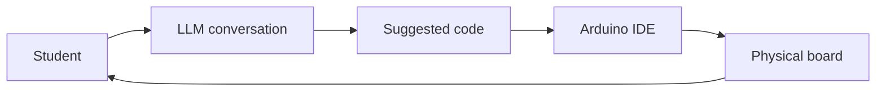
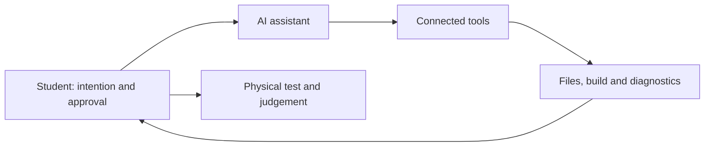

# Day 3 — AI-Assisted Arduino Programming

**RC15 Skills · Prosthetic Clouds · 2026/27 · Four-hour workshop**

On Day 1, we learned to read and write Arduino code. On Day 2, we built a modular GSR/GPS/SD data logger. Today we use a large language model (LLM) to explore programmable light and extend an existing system.

**The objective is not to avoid programming. It is to develop stronger ideas, clearer specifications and better judgement about the code we create.**

We begin with the Arduino Uno R4 WiFi's **built-in 12 × 8 LED matrix**, then return to the Day 2 logger. No external LED hardware is required today.

## Learning outcomes

- Discuss a technical and visual idea with an LLM **before requesting code**.
- Turn an intention into a testable specification.
- Generate, inspect, upload and refine Arduino sketches.
- Develop patterns, animations and communication behaviours using the onboard matrix.
- Understand possibilities for external LED arrays and LEDs integrated into textiles.
- Modify the Day 2 logger while preserving its modular organisation.
- Distinguish ordinary chat, tool calling, agents and MCP.

## Workshop structure

| Time | Exercise | Outcome |
| --- | --- | --- |
| 00:00–00:30 | **001 — AI as a programming collaborator** | Think, discuss and specify |
| 00:30–01:15 | **002 — LED matrix experiments** | A working animated pattern |
| 01:15–02:00 | **003 — From prompt to working behaviour** | A refined visual language |
| 02:00–03:30 | **004 — Modify the Day 2 data logger** | One tested new capability |
| 03:30–04:00 | **005 — Agents, MCP and reflection** | Understand further possibilities and limitations |

**Bring:** Arduino Uno R4 WiFi, USB-C data cable, computer with Arduino IDE 2.x, and access to an LLM. For Exercise 004, bring the Day 2 logger components (GSR sensor, GPS receiver and SD module) where available.

---

# 001 — AI as a Programming Collaborator

## Think → Discuss → Specify → Code → Test → Reflect

An LLM can generate code quickly. But compiling successfully does not mean a program behaves as intended.

1. **Think:** What do you want the device to do? Sketch the behaviour.
2. **Discuss:** Ask the LLM about alternative approaches, assumptions and constraints.
3. **Specify:** Define the board, inputs, outputs, timing and criteria for success.
4. **Code:** Request a small working version before adding complexity.
5. **Test:** Upload to the *physical* Arduino and observe the result.
6. **Reflect:** Compare intention with observation and decide what to change.

**Rule for the opening conversation:** Do not request code yet. First explore the problem and its possibilities.

### Example conversation

> I am using an Arduino Uno R4 WiFi with its built-in 12 × 8 LED matrix. I want to create a moving light pattern that feels like a wave travelling across a surface. Before writing code, help me explore three possible visual behaviours. Explain how each might work, which parameters I could control, and how I could test the result on the board.

Notice that this establishes the **hardware**, **creative intention** and **stage of work**.

### Keep your judgement

LLMs may invent library functions, confuse Arduino boards or propose hardware that is not connected. Verify unfamiliar claims using the board documentation and library examples. Treat generated code as a proposal, not as an authority.

---

# 002 — LED Matrix Experiments

## A small canvas for programmable light

The Uno R4 WiFi includes a **12-column × 8-row monochrome LED matrix**. Its 96 LEDs allow us to experiment with symbols, sequences, patterns and animations without any wiring.

The onboard matrix is not an individually addressable RGB display. Work instead with **position, rhythm, repetition, density and movement**.

References: [Arduino Uno R4 WiFi](https://docs.arduino.cc/hardware/uno-r4-wifi/) · [Arduino LED matrix tutorial](https://docs.arduino.cc/tutorials/uno-r4-wifi/led-matrix/).

## Verify the hardware first

In the Arduino IDE, select **Arduino Uno R4 WiFi**, open an LED matrix example and upload it. Check that the display works before introducing AI-generated code.

A minimal static frame example:

```cpp
#include <Arduino_LED_Matrix.h>

ArduinoLEDMatrix matrix;

const uint32_t frame[] = {
  0x00000000,
  0x00F00F00,
  0x00000000
};

void setup() {
  matrix.begin();
  matrix.loadFrame(frame);
}

void loop() {
}
```

The frame uses the library's packed representation of 12 × 8 pixels. The [Arduino LED matrix editor](https://ledmatrix-editor.arduino.cc/) and official examples help explain how frames are constructed. Ask the LLM to explain the representation it uses.

## Exercise A — Describe a visual idea

Choose or invent a behaviour:

- A pulse travelling from one edge to another.
- Ripples expanding from a point.
- A constellation of flickering points.
- A transition between order and randomness.
- A simple symbol or pattern representing a message.

**Before generating code**, ask the LLM for three interpretations. Select one, then agree on direction, duration, speed and repetition. Request a minimal sketch for the **Uno R4 WiFi onboard matrix** and upload it.

**Outcome:** A working pattern you can explain and demonstrate.

## Exercise B — Make the pattern more expressive

Treat the LED matrix as a tiny design surface. Explore:

- **Rhythm:** steady, irregular, accelerating or slowing pulses.
- **Movement:** diagonals, waves, rotation, travelling points.
- **Density:** sparse, clustered or dispersed pixels.
- **Transformation:** growth, fragmentation, merging or disappearance.
- **Communication:** a pattern associated with a recognisable state.

Ask the LLM to make useful parameters easy to change, such as `speed`, `density` and `direction`. Change one parameter at a time.

### Frame-by-frame versus procedural animation

A **frame-by-frame** animation displays predefined images in sequence. A **procedural** animation calculates pixel states from rules or equations.

Which is better for your design? Stored frames may be suitable for a repeated icon; procedural approaches may better suit evolving waves or generative patterns.

**Challenge:** Can a few simple rules produce a visually rich behaviour?

---

# 003 — From Prompt to Working Behaviour

## Design a visual language

Imagine your Arduino needs to communicate three states without text:

1. **Ready:** powered on and waiting.
2. **Recording:** actively collecting information.
3. **Attention:** something requires a response.

Design a distinct animation for each. Think about recognisability, not simply visual complexity.

### Step 1 — Specify

| Question | Example |
| --- | --- |
| Hardware? | Uno R4 WiFi onboard 12 × 8 matrix |
| States? | Ready, recording, attention |
| Visual behaviours? | Slow pulse, travelling line, repeating alert |
| Adjustable parameters? | Speed, repetition, spatial distribution |
| Test? | Can another student distinguish the three states? |

### Step 2 — Generate and inspect

Ask for a sketch organised into small functions, for example `showReady()`, `showRecording()` and `showAttention()`. Request comments explaining the visual logic. Check that the generated code uses the correct board and matrix library.

### Step 3 — Observe and refine

Upload the sketch. Describe **what actually happened** to the LLM. A photo or short video can help. Request focused revisions: for example, “Keep the recording animation but make the movement less regular.”

### Step 4 — Document

Save the sketch and record:

- The original visual intention.
- The main changes made during your conversation.
- One decision **you** made.
- One limitation or unresolved question.

## Beyond the Onboard Matrix — Light as a Material and Communication Medium

**This is a discussion chapter, not an additional hardware exercise.** Today we only program the onboard matrix. The same ideas can, however, extend to much larger, coloured and spatially distributed systems.

### External LED matrices and strips

Commercially available matrices and individually addressable RGB strips (such as WS2812-family devices) offer colour, more pixels and flexible physical arrangements. They can create gradients, travelling signals, distributed animations and generative fields.

They also introduce new design requirements: power supply, voltage, current draw, wiring, layout and libraries. **A large LED array must not be powered directly from an Arduino output pin.**

### LEDs integrated into fabric

LEDs can be sewn, attached or embedded in textiles, becoming part of a wearable surface rather than a conventional screen. Folds, diffusion, movement and the distance between LEDs affect how the pattern is perceived.

This creates a bridge to **Arantza's textile workshop**. Imagine:

- A signal travelling across a garment.
- A pulse responding to physiological measurements.
- A distributed light field changing as a textile moves.
- Patterns that communicate between the wearer and the surrounding environment.

The purpose is to begin thinking of **light as programmable information and as a material of spatial design**.

---

# 004 — Modify the Day 2 Data Logger

## Extend a system you already understand

On Day 2 we developed a modular logger:

- `readGSR()` — acquire skin-response readings.
- `readGPS()` — receive and parse location/time data.
- `saveData()` — write a CSV record to the SD card.

Today we use AI to **modify that working system**, not replace it with a completely unfamiliar sketch.

## Choose one modification

**Option A — Communicate through light.** Display the logger's state on the onboard LED matrix: waiting for GPS, recording, or SD-card error. This connects directly to the earlier LED exercises.

**Option B — Record without GPS.** Continue recording GSR data at a defined interval even without a valid GPS fix. Mark missing location values clearly in the CSV.

**Option C — Improve timing.** Explore a `millis()`-based approach that avoids unnecessary blocking delays and allows more regular GPS processing and GSR sampling.

**Option D — Your own extension.** Propose a change that can be demonstrated and tested within the workshop.

### Stage 1 — Discuss before coding

Show the LLM the **actual Day 2 sketch**. Explain what works, what you want to change and which parts must remain intact.

> We have a working Arduino Uno R4 WiFi logger using GSR, GPS and an SD card. It is organised into `readGSR()`, `readGPS()` and `saveData()`. I want to add an LED-matrix status display. Do not generate code yet. Help me identify the required states, which functions should change, and any conflicts with GPS reception or SD writing.

### Stage 2 — Define success

For Option A, example tests are:

| Test | Expected result |
| --- | --- |
| Power on without a GPS fix | Waiting pattern |
| Valid GPS data and successful SD writes | Recording pattern |
| SD card unavailable at startup | Distinct error signal |

Discuss transitions and priorities: should a warning interrupt another animation? Should a pattern restart when its state changes?

### Stage 3 — Change the smallest useful part

Ask the LLM to **preserve pin assignments, CSV structure and existing modules** unless a change is essential. Request an explanation of each edit. Compare new and old versions.

### Stage 4 — Test the complete system

Upload the code and run the agreed tests. **Check the CSV data as well as the LED display.** An attractive animation is not a successful modification if it interrupts logging.

When something fails, describe the observed behaviour and relevant error messages. Ask for a diagnosis before requesting another full rewrite.

### Stage 5 — Demonstrate and explain

Be ready to show the original behaviour, intended modification, actual result and at least one design or technical decision you can explain independently.

**Outcome:** One tested extension of the Day 2 logger, with understandable changes and a brief record of your reasoning.

---

# 005 — Agents, Tool Calling and Reflection

## Beyond copying code from a chat

In today's exercises, the workflow is:



The student evaluates suggestions, uploads the code and observes the hardware.

**Tool calling** lets an AI assistant request actions through connected tools. An **agentic workflow** may combine steps such as reading project files, editing code, running a build and interpreting diagnostics.

**MCP (Model Context Protocol)** is one way to connect AI applications to external tools and information. MCP does not itself guarantee that an assistant can compile, upload or control an Arduino. Those capabilities depend on the actual connected tools and their permissions.



### Reflect

- When did AI make it possible to attempt something more ambitious?
- When did it introduce unnecessary complexity?
- Which parts of the generated code do you understand?
- What did you learn only by testing the physical Arduino?
- Which actions would you allow an agent to perform automatically, and which should require your approval?

## Before leaving

Save your final sketch, specification and evidence of testing. Keep the original Day 2 sketch so you can compare versions and restore a working system.

**Central lesson:** AI can accelerate experimentation, but design intention, technical understanding and critical judgement remain yours.

---

## Further reading and optional extensions

- [Arduino Uno R4 WiFi documentation](https://docs.arduino.cc/hardware/uno-r4-wifi/)
- [Arduino LED matrix tutorial](https://docs.arduino.cc/tutorials/uno-r4-wifi/led-matrix/)
- [Arduino language reference](https://docs.arduino.cc/language-reference/)
- Earlier **Design to Fabrication** tutorials in this repository cover Arduino/Python/Grasshopper connections, OSC, fabrication and PCB design. These remain reference material rather than required exercises for today's workshop.
